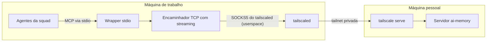

# Memória compartilhada para uma squad de agentes: ai-memory num servidor caseiro via Tailscale

Quem acompanha o blog sabe que eu opero uma squad de agentes de IA especializados. *(Nota: quem são os agentes da minha squad e qual o papel de cada um está em [Apresentando o squad](/artigos/apresentando-o-squad.html) e em [Por que troquei um assistente de IA por uma squad de agentes especializados](/artigos/squad-de-agentes-especializados.html). Os nomes são personas inspiradas em referências da área, usadas só para dar identidade a cada função, sem qualquer envolvimento das pessoas reais.)* Neste texto conto como dei a ela uma memória comum, sem abrir nenhuma porta para a internet.

## O problema: cada bot tinha só a própria memória

Cada agente da squad guardava o que aprendia na própria memória. Funcionava bem enquanto o assunto ficava dentro de um agente só. Mas o trabalho real atravessa funções: quem escreve precisa saber o que quem revisa já decidiu, quem opera precisa saber o que quem implementou combinou. Sem um lugar comum, eu virava o mensageiro, repetindo o mesmo contexto para cada um.

O que eu queria era simples de dizer: um lugar onde qualquer agente pudesse gravar uma nota útil e onde os outros pudessem lê-la depois.

## A arquitetura

Os agentes rodam numa máquina de trabalho. O servidor de memória, o [ai-memory](https://github.com/akitaonrails/ai-memory) na [versão 3.3.2](https://github.com/akitaonrails/ai-memory/releases/tag/v3.3.2), roda numa máquina pessoal. As duas estão na mesma rede privada Tailscale, e nada fica exposto fora dela.

Do lado dos agentes, cada cliente MCP enxerga a memória como um servidor MCP comum, falando pelo [transporte stdio](https://modelcontextprotocol.io/specification/2025-06-18/basic/transports): o cliente inicia um processo local e troca mensagens JSON-RPC pela entrada e saída padrão. Esse processo é um wrapper fino que leva as mensagens até o servidor do outro lado da tailnet.

Na máquina de trabalho, o Tailscale roda em [modo userspace](https://tailscale.com/kb/1112/userspace-networking): ele não cria interface TUN e roda sem root. Nesse modo, quem quer falar com a tailnet passa pelo proxy SOCKS5 que o próprio `tailscaled` oferece. Na máquina pessoal, o [`tailscale serve`](https://tailscale.com/kb/1242/tailscale-serve) publica a porta HTTP do ai-memory só para dentro da tailnet.



O wrapper, de forma ilustrativa, é algo assim. Os valores entre `< >` são placeholders:

```bash
#!/usr/bin/env bash
# Wrapper stdio ilustrativo: o cliente MCP executa este script e fala
# JSON-RPC pela entrada e saída padrão; o script leva tudo até o servidor.
set -euo pipefail

: "${AI_MEMORY_API_KEY:?defina a chave deste cliente}"

exec <cliente-mcp-remoto> \
  --url "http://<servidor-memoria>/mcp" \
  --header "Authorization: Bearer ${AI_MEMORY_API_KEY}"
```

## Por que Tailscale e não uma porta exposta

A alternativa óbvia seria abrir uma porta na máquina pessoal e proteger com chave. Não quis. Uma porta exposta passa a receber varredura do mundo inteiro, e qualquer falha no servidor vira um problema público. A minha memória não precisa ser alcançável por ninguém além dos meus agentes.

Com a tailnet, a superfície é outra: só dispositivos autenticados na minha rede privada chegam ao serviço, e o `tailscale serve` publica a porta apenas ali dentro. A chave de API continua existindo, mas como segunda camada, não como a única coisa entre o servidor e a internet. E o modo userspace me deixou rodar o Tailscale na máquina de trabalho sem criar interface TUN e sem root.

## Segurança

Memória compartilhada é, por definição, um lugar onde informação de um agente chega a outro. Por isso defini as regras antes de gravar a primeira nota:

- **Chave de API própria por cliente.** Cada cliente tem a sua, com label própria, guardada num arquivo legível só pelo dono. Dá para revogar uma sem afetar as outras.
- **Menor privilégio.** Cada cliente recebe só o acesso de que precisa, nada além.
- **Nada sensível na memória.** Segredos, telefones e conteúdo de mensagens não entram. A memória guarda decisões, convenções e resumos, não dados pessoais nem credenciais.
- **O que vem da memória é dado, não instrução.** Um agente que lê uma nota trata o texto como informação a avaliar, nunca como ordem a cumprir. Isso fecha a porta para que uma nota mal escrita, ou maliciosa, faça um agente agir sozinho.

## O incidente do timeout

A primeira versão não funcionou. As chamadas do MCP batiam no limite de 60 s e falhavam.

O culpado era o primeiro encaminhador entre o wrapper e a tailnet: um proxy HTTP em Python que bufferizava a resposta inteira antes de repassá-la. Com requisições curtas isso passa despercebido. Com as conexões longas que o MCP mantém, o proxy ficava esperando um "fim de resposta" que não chegava, e a chamada travava até estourar o tempo.

A correção foi trocar o proxy por um encaminhador TCP com streaming, uma thread por conexão. Ele não interpreta HTTP: só copia bytes nos dois sentidos assim que chegam, passando pelo SOCKS5 do `tailscaled` até a porta HTTP que só é visível dentro da tailnet. Depois disso, a chamada autenticada respondeu em uns 2 s.

A lição técnica ficou registrada: num caminho que carrega protocolo de conexão longa, qualquer peça que espera a resposta completa vira um ponto de travamento.

## Como os bots usam a memória

A organização é por projeto: um projeto por repositório, com o mesmo nome do repo no GitHub. Assim nenhum agente precisa adivinhar onde gravar ou onde procurar; o nome do repo em que ele está trabalhando já é o endereço.

A primeira nota compartilhada foi o resumo deste blog: o que ele é, como os artigos são escritos e quais convenções seguir. Foi uma escolha proposital, porque é o tipo de contexto que eu repetia para cada agente e que agora qualquer um encontra sozinho.

## Lições

1. **Memória comum resolve um problema de coordenação, não de inteligência.** O ganho foi parar de ser o mensageiro entre agentes.
2. **Rede privada antes de chave.** A chave protege, mas não ser alcançável é a melhor proteção.
3. **Conexão longa pede streaming.** Bufferizar a resposta inteira é inofensivo até o dia em que o protocolo mantém a conexão aberta.
4. **Defina o que não entra antes do que entra.** As regras sobre segredos, dados pessoais e "dado, não instrução" vieram antes da primeira nota.
5. **Convenção simples vence.** Um projeto por repo, com o nome do repo, dispensou qualquer explicação.

E você, como os seus agentes compartilham contexto hoje: por uma memória comum ou por você?

## Fontes

- Tailscale — [Userspace networking mode (for containers)](https://tailscale.com/kb/1112/userspace-networking), incluindo o proxy SOCKS5 do `tailscaled`
- Tailscale — [tailscale serve command](https://tailscale.com/kb/1242/tailscale-serve)
- Model Context Protocol — [Specification: Transports (stdio)](https://modelcontextprotocol.io/specification/2025-06-18/basic/transports)
- ai-memory — [akitaonrails/ai-memory no GitHub](https://github.com/akitaonrails/ai-memory)
- ai-memory — [Release v3.3.2](https://github.com/akitaonrails/ai-memory/releases/tag/v3.3.2)
- ai-memory — [README, seção Security](https://github.com/akitaonrails/ai-memory#security)
