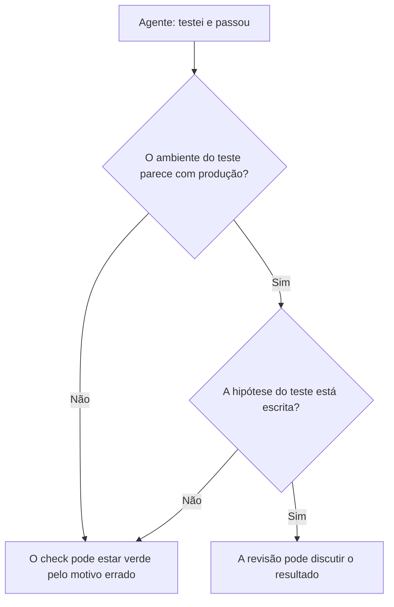

# O teste passou no hardware errado: o que o apagão do Microsoft 365 ensina à minha squad

Um update de julho passou no teste de carga e no deploy “sem impacto”. Em novembro, o e-mail de muita gente no mundo parou. Não é um trocadilho: é o que o relatório preliminar de incidente da Microsoft, datado de 15 de novembro de 2026, descreve sobre a queda do Exchange Online e de outros serviços do Microsoft 365 nos dias 12 e 13.

Li esse PIR — e a cobertura do Register no dia 16 — com a mesma pergunta que faço nos post-mortems deste blog: o que disso eu consigo aplicar amanhã, sem transformar relatório de terceiros em experiência minha? Escrevo em primeira pessoa, como engenheiro que opera uma squad de agentes de IA e que já tratou aqui de testes que passam pelo motivo errado. *(Nota: quem são os agentes da minha squad e qual o papel de cada um está em [Apresentando o squad](/artigos/apresentando-o-squad.html) e em [Por que troquei um assistente de IA por uma squad de agentes especializados](/artigos/squad-de-agentes-especializados.html). Os nomes são personas inspiradas em referências da área, usadas só para dar identidade a cada função, sem qualquer envolvimento das pessoas reais.)*

O documento é preliminar. A própria Microsoft avisa que as informações podem mudar e que um PIR final deve sair em até cinco dias úteis após a resolução — o próprio relatório agenda a lista completa de reparos para 20 de novembro de 2026. O que segue está amarrado a essa versão de 15/11, nos incidentes EX1550543 e MO1550821, não a um fechamento que ainda não li.

## O que caiu, e por quanto tempo

Segundo o PIR, o impacto principal foi no Exchange Online: a maior parte dos usuários não conseguia acessar a caixa de correio pelo Outlook ou por outros clientes, e a entrega de e-mail atrasou para muitos. Outros serviços que dependem do Exchange — trechos de Copilot, Teams, SharePoint, OneDrive, Defender e Purview, entre os citados — também sentiram, embora a Microsoft afirme que a maior parte desses serviços tenha permanecido no ar e acessível. A gravidade variou por região, forma de conexão e momento.

A janela oficial de incidente começa às 16:20 UTC de 12 de novembro e termina às 16:10 UTC de 13 de novembro (13:20 às 13:10 no horário de Brasília). A comunicação final com os clientes, depois de um período de monitoramento, saiu às 04:15 UTC de 14 de novembro.

## Três fatores, nenhum suficiente sozinho

A Microsoft descreve três fatores que, juntos, derrubaram o *networking gateway* que fica na frente de vários serviços do Microsoft 365.

O primeiro é um defeito latente. Um *fix* preparado especificamente para os servidores de gateway do Microsoft 365 — o PIR diz que nem o defeito nem a correção se aplicam ao Windows de forma geral — introduziu contenção de lock num processo interno do Windows. Sob certas condições de carga, isso esgotava CPU e memória e deixava o servidor unresponsive. O comportamento novo começou a ser implantado em julho de 2026, passou por *safe deployment*, saturando o mundo ao longo de várias semanas, e ficou mais de três meses no ar sem impacto observado.

A frase que ficou comigo é a do teste. O PIR afirma que o load test normal não detectou o problema latente “because the traffic mix and SKUs used in our labs”. E esclarece: a contenção piora em máquinas com mais núcleos e hardware mais novo; o teste de carga tendia a focar hardware mais fraco, com menos núcleos. O Register, no dia 16, destaca o mesmo ponto. Em português claro: o teste foi verde no hardware errado.

O segundo fator foi um aumento de carga. Cerca de quinze horas antes da queda, às 01:07 UTC de 12 de novembro, o Teams fez failover do gateway alternativo para o gateway “primário”, que também atende o Exchange Online. Segundo a Microsoft, esse tipo de failover faz parte da operação normal de resiliência. Sozinho, não deveria ter bastado.

O terceiro: quase 14% da capacidade de servidores daquele gateway estava fora de serviço por um problema não relacionado, do dia anterior, e já seguia rumo à volta por manutenção de rotina. O PIR diz que havia folga de capacidade e que essa redução, isolada, também não teria impacto.

Juntos, carga extra e capacidade menor levaram o gateway a encontrar o bug de julho, no pico de tráfego dos Estados Unidos. As requisições se acumularam até os servidores pararem de responder. O sistema de tráfego, como de costume, desviou usuários para outros *endpoints* saudáveis — e isso aumentou a chance de o mesmo defeito aparecer no que restava. Em menos de duas horas, o defeito até então desconhecido se espalhou pela frota. No ponto mais baixo, mais de 80% dos servidores estavam unresponsive. O PIR acrescenta que as anteparas (*bulkheads*) entre as partições de capacidade, por um problema à parte, não impediram a cascata global.

Serviços que podiam sair daquele gateway — o texto cita Teams, OneDrive, SharePoint e aplicativos do Office — falharam para fora e se recuperaram em parte mais cedo; o PIR diz que chats e reuniões do Teams funcionaram sem problema durante a maior parte da queda. O Exchange Online, por escala, não tem esse caminho.

## Por que o rollback não salvou o dia

A recuperação atrasou por dois motivos que qualquer quem escreve runbook reconhece. Quando um servidor voltava, o tráfego em espera o derrubava de novo. Os processos automatizados de recovery, diz o PIR, não foram desenhados para restaurar o serviço a partir daquele estado amplo de unresponsiveness. E, como o defeito principal era um bug latente de meses, rollback, *flighting* e feature flags habituais não conseguiram reverter a mudança com rapidez.

A linha do tempo oficial mostra a procura: o monitor de anomalia de conectividade acende às 16:03 UTC do dia 12; o alerta de alta prioridade e a comunicação no Service Health Dashboard (EX1550543) vêm às 16:20; o primeiro chamado de suporte associado ao incidente mais amplo chega às 16:33. Ao longo da noite, restart, redirecionamento e mudanças pontuais não sustentam a recuperação — servidores que voltavam caíam de novo ao receber tráfego. Às 00:30 UTC de 13 de novembro a equipe identifica a negociação de conexão como área principal; às 07:20 UTC aplica a mitigação: um update que devolvia o caminho de código ao estado conhecido como bom, primeiro numa parte da capacidade, depois expandindo. Às 16:10 UTC do dia 13 a Microsoft confirma que os clientes não sofriam mais impacto ativo daquele incidente.

Não foi um rollback clássico. Foi, nas palavras do próprio relatório, um update que “returned the code path to the previously known good state in Windows”, aplicado em grupos grandes de servidores (o exemplo dado é mais de 50% de uma região), com restart controlado antes de devolver a máquina à frota.

## O que eu levo para a squad

Não vivo o Microsoft 365 por dentro. O que me interessa é o padrão, o mesmo que já discuti em [O teste passou, mas pelo motivo errado](/artigos/testes-que-passam-pelo-motivo-errado.html): um check verde não prova que você mediu a coisa certa.

Quando um agente da squad diz “testei e passou”, a pergunta que eu quero fazer — e que recomendo — não é só *passou?*. É *em que máquina, com que carga, contra qual hipótese?*. Se o teste roda num ambiente mais fraco do que produção, ele pode ser exatamente o load test de julho: honesto no lab, cego no hardware que importa.

Três práticas que procuro seguir e que este PIR reforça:

1. **Pedir o cenário do teste, não só o resultado.** Um PR de agente com CI verde deveria dizer, ainda que em poucas linhas, onde a suíte rodou e o que ela não cobre. Se ninguém souber, o “passei” não está completo.
2. **Desconfiar de fatores “inofensivos” somados.** Failover rotineiro e capacidade temporariamente menor, isolados, não derrubariam o gateway, segundo a Microsoft. Juntos, acionaram o defeito latente. No tabletop da squad, vale a pergunta: quais duas mudanças “seguras” a gente aceitaria no mesmo dia sem um plano de contenção?
3. **Escrever o recovery para o estado feio, não só para o estado previsto.** O PIR admite que a automação habitual não foi desenhada para aquele cenário de frota unresponsive, nem o rollback rápido para um defeito de meses. Um runbook que só cobre o caminho feliz é primo do teste no hardware errado.

Nada disso é “não use automação”. É o contrário: usar a squad de um jeito que o teste continue medindo o que importa, não só o que é conveniente rodar no lab.

O PIR final, previsto para 20 de novembro, pode ajustar causa, números e reparos. Se ele mudar o quadro, o lugar de corrigir é aqui, com data e fonte, não no silêncio. Até lá, a lição que eu levo já cabe numa pergunta só: quando a esteira fica verde, ela testou o hardware — e a hipótese — certos?

## Fontes

- Microsoft — *Preliminary Post Incident Report* for Microsoft 365, 15/11/2026, incidentes EX1550543 / MO1550821 (cópia pública do documento datado de 15 de novembro: [PDF](https://next.ink/wp-content/uploads/2026/11/PostIncidentReport.pdf)). O PIR preliminar foi disponibilizado aos clientes no Microsoft 365 Admin Center; um relatório final deve suceder este documento.
- The Register — [Microsoft blames monster email outage on software defect introduced in July fix](https://www.theregister.com/saas/2026/11/16/microsoft-blames-monster-email-outage-on-software-defect-introduced-in-july-fix/5310026), de Richard Speed, 16/11/2026
- BleepingComputer — [Microsoft says months-old bug caused global Microsoft 365 outage](https://www.bleepingcomputer.com/news/microsoft/microsoft-says-months-old-bug-caused-global-microsoft-365-outage/) (cobertura do mesmo PIR)
- Artigos deste blog citados no texto: [O teste passou, mas pelo motivo errado](/artigos/testes-que-passam-pelo-motivo-errado.html)
