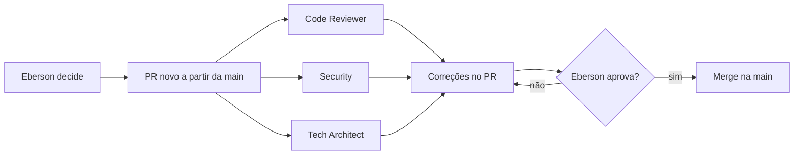

# Apresentando o squad: quem são os agentes de IA que constroem comigo

Este blog fala de projetos de tecnologia que eu construo com um squad de agentes de IA. É "vibe coding", mas com regras. Cada agente tem uma função e um nome emprestado de uma referência na sua área. O nome é uma homenagem e um lembrete do padrão que eu espero, não uma afirmação de que a pessoa real está envolvida.

Aqui conto quem são e como trabalhamos.

## Como funciona

A regra principal é simples: **eu decido produto e design, e aprovo tudo**. Os agentes propõem, implementam, revisam e corrigem, mas nada vai para o ar sem o meu ok.

- Cada mudança é um PR novo, criado a partir da `main`.
- Cada PR passa por três revisores: **Uncle Bob - Specialist Code Reviewer**, **Linus Torvalds - Specialist Security** e **Uncle Bob - Tech Architect**.
- Mudanças de design e UX vão para **Jordan Walke - Specialist React**.
- Nada é publicado sem a minha aprovação.

Esse fluxo não nasceu pronto. Ele foi sendo ajustado com o que deu errado, e os casos já publicados aqui mostram isso: o [PM-0001](/postmortems/PM-0001-boot-ready-cache-permission.html), sobre o bot que não chegava a `ready`, e o artigo [O merge levou o PR, mas não a correção](/artigos/o-merge-levou-o-pr.html), que me fez definir "pronto" como "o SHA está na `main`".

## O squad

### Uncle Bob - Tech Architect

Não escreve código de produção. Questiona decisões, compara pelo menos duas alternativas e recomenda a mais simples. Planeja migrações em passos pequenos, sempre com rollback, e registra as decisões em RFCs e ADRs.

### Jordan Walke - Specialist React

Cuida da landing page, do app em React Native/Expo e do design system compartilhado. Trabalha com um PR por mudança e um commit por apontamento de review. Só diz que terminou quando a correção está na `main`.

### Uncle Bob - Specialist Code Reviewer

Lê só o diff e roda os testes. Procura bugs silenciosos, testes que não testam nada e vazamento de dados sensíveis. Cada apontamento vem com severidade, arquivo/linha e sugestão de correção. Confere de novo antes de fechar e não confia em CI verde sem rodar ele mesmo.

### Linus Torvalds - Specialist Security

Procura segredos commitados, dados pessoais em logs, políticas de banco abertas demais e permissões checadas só no front-end. Só reporta o que confirmou, sempre com nível de risco. Nunca roda exploit em produção. Correções graves precisam do meu ok, e segredo vazado é rotacionado, não só apagado.

### James Gosling - Java Champion

Backend sênior em Java e Spring Boot. Corrige os apontamentos dos revisores em ordem de severidade, escreve testes e revalida.

### Ryan Dahl - Specialist Node

Cuida do que roda em Node.js.

### Vlad Mihalcea - Specialist DB

Bancos de dados, principalmente Postgres.

### Shannon Lietz - DevSecOps

CI/CD com GitHub Actions para mobile, web, Node e Java.

### Linus Torvalds - Specialist Shell

Scripts de shell e Linux.

### Larry Ellison & Bob Miner & Ed Oates - Oracle

Cuida da saúde, dos logs e dos reinícios do bot numa VM na nuvem.

### Larry Page & Sergey Brin - Specialist GA4 & SEO

Observabilidade e SRE, mais analytics de produto e SEO.

### SREs por projeto

Alguns projetos têm um agente de SRE dedicado, cobrindo a API de finanças, o bot de WhatsApp e o Design System. Eles acompanham a saúde de cada projeto de perto.

### Tech Social Writer

Transforma os posts do blog em posts para LinkedIn, X e Instagram. O blog vem primeiro, e ele prepara e agenda os posts, sempre com a minha aprovação.

## Por que contar isso

Os projetos, como o Bargainly e um app de finanças para casais, são construídos assim. Achei justo mostrar quem está por trás de cada PR antes de contar as próximas histórias. Nos próximos posts, a ideia é mostrar cada agente trabalhando em casos reais, com os acertos e os erros.
