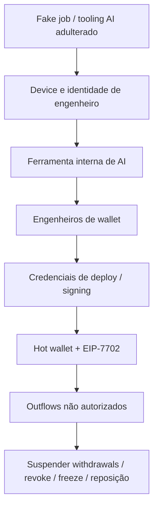

# O ataque de US$ 6,3 bilhões à Binance: entrevista falsa, tooling de IA e o serviço de assinatura

Quando leio um post-mortem de exchange, ainda procuro a frase confortável: *"as chaves frias estavam intactas"*. No incidente da Binance de 29 de outubro de 2026, essa frase não basta. O que a empresa descreveu depois, em briefing de 3 de novembro, foi uma **campanha construída ao longo de meses** — não um clique solitário num laptop — até alguém conseguir autorizar movimentações fora do fluxo normal de saque.

Escrevo isto como engenheiro que acompanha incidentes públicos para melhorar o que a minha squad faz no dia a dia. *(Nota: quem são os agentes da minha squad e qual o papel de cada um está em [Apresentando o squad](/artigos/apresentando-o-squad.html) e em [Por que troquei um assistente de IA por uma squad de agentes especializados](/artigos/squad-de-agentes-especializados.html) — os nomes, como `Linus Torvalds - Specialist Security` e `Shannon Lietz - DevSecOps`, são personas inspiradas em referências da área apenas para dar identidade a cada função, sem qualquer envolvimento das pessoas reais.)*

## O que a Binance disse que aconteceu

No [Security Incident Update de 30 de outubro de 2026](https://www.binance.com/en/support/announcement/detail/c5a8729a97ac486d963784d96c5642d7), a Binance estimou o impacto total em torno de **US$ 6,3 bilhões**. Naquele comunicado preliminar, a hipótese inicial apontava para o laptop comprometido de um engenheiro DevOps, que teria permitido acesso a um *service container* e a *withdrawals* não autorizados. A empresa afirmou **não ter encontrado evidência de vazamento de private key** de carteira e prometeu um post-mortem técnico detalhado quando a investigação estivesse completa.

Três dias depois, o quadro ficou maior. Em briefing coberto pelo [CoinDesk em 3 de novembro de 2026](https://www.coindesk.com/business/2026/11/03/binance-s-usd6-3-billion-hack-began-with-a-fake-job-interview-exchange-says) e pelo [CNBC no mesmo dia](https://www.cnbc.com/2026/11/03/binance-co-ceo-teng-says-hackers-used-fake-job-interviews-to-steal-6point3-billion-in-crypto.html), o co-CEO Richard Teng rejeitou a leitura de “um único ponto de falha num notebook” e descreveu uma campanha de meses. Segundo a Binance e a imprensa (CoinDesk e CNBC, 3/11/2026), o FBI teria atribuído o ataque a atores ligados à Coreia do Norte (grupo TraderTraitor / Lazarus) — isso é o que a exchange/reportagem relatam, **não** uma declaração do FBI que eu tenha verificado diretamente. No CNBC, o co-CEO Richard Teng **não atribuiu pessoalmente** o ataque à Coreia do Norte, mas reconheceu o vínculo que a imprensa associa ao FBI.

Números que aparecem nas fontes — sempre com data e emissor:

| Número | O que representa | Fonte e data |
|---|---|---|
| ~US$ 6,3B / US$ 6,34B | Impacto total estimado (ativos afetados) | Binance, 30/10/2026; CNBC citando a empresa, 3/11/2026 |
| ~US$ 2,5B | Dreno em Ethereum via EIP-7702 numa hot wallet rotulada “Binance 14” | CoinDesk (tech), 30/10/2026 — **parte** do total, não o total |
| ~US$ 3B | Ativos congelados on-chain | Binance, update de 30/10/2026 |
| ~US$ 2,85B | Ativos frozen/intercepted | CoinDesk e CNBC, 3/11/2026 (número de outra data; não misturar com os ~US$ 3B do dia 30) |
| ~98% | Tokens afetados reabastecidos com fundos da empresa | CNBC e CoinDesk, 3/11/2026 — reposição ≠ recuperação dos fundos roubados |
| 57 | Tentativas que a Binance descreve como suspeitas e ligadas a NK, bloqueadas no ano | CoinDesk, 3/11/2026 (claim da empresa, via imprensa) |

A Binance afirmou que cobriria as perdas com o fundo SAFU e recursos próprios, e que os fundos dos usuários estavam seguros ([anúncio de 30/10](https://www.binance.com/en/support/announcement/detail/c5a8729a97ac486d963784d96c5642d7)).

## Linha do tempo da campanha (conforme briefing)

Horários em UTC, conforme a cobertura do CoinDesk/CNBC citando o briefing e o relatório preliminar da Binance de 3 de novembro de 2026:

1. **Junho de 2026.** Um engenheiro DevOps da área de Wallet baixou uma instalação Homebrew adulterada ao procurar uma ferramenta popular de AI. A Binance diz ter detectado a atividade suspeita, trocado o device e rotacionado credenciais — mas, segundo o relatório citado pelo CNBC, o papel desse engenheiro e de colegas da equipe de infraestrutura de wallet já tinha sido exposto ao atacante.
2. **Setembro de 2026.** Outro engenheiro foi contatado em plataforma de emprego legítima. Houve entrevista falsa com “HR”, depois com um “CEO”, e um exercício de código com malware zero-day instalado no notebook de trabalho (Jimmy Su, CSO, via CoinDesk).
3. **20 de outubro de 2026.** Atacantes usaram a máquina comprometida pela entrevista falsa e uma **ferramenta interna de AI** para alcançar computadores de dois engenheiros de wallet (CoinDesk).
4. **29 de outubro de 2026, ~20:05 UTC.** Credenciais roubadas usadas para deploy de container e script malicioso; fundos começam a sair (CoinDesk).
5. **~20:20 UTC.** Na Ethereum, uma transação carrega 50 autorizações **EIP-7702** assinadas pela hot wallet “Binance 14”; em minutos, cerca de **US$ 2,5 bilhões** saem dessa wallet ([CoinDesk tech, 30/10](https://www.coindesk.com/tech/2026/10/30/here-s-how-one-ethereum-permission-let-an-attacker-drain-usd2-5-billion-from-binance)).
6. **23:56 UTC.** Última transferência não autorizada, segundo findings preliminares relatados na imprensa.
7. **30 de outubro, 00:10 UTC.** Contenção: a delegação EIP-7702 é limpa / a autorização é revogada (CoinDesk + anúncio Binance). Segundo a Binance, as hot wallets usam *multiparty computation* (MPC), o que teria dificultado uma revogação imediata por uma única chave.

**O que ainda é preliminar.** Continua em aberto *como* as assinaturas EIP-7702 foram produzidas (laptop vs serviço de assinatura vs chave). A Binance insiste que não há evidência de leak clássico de private key; análises de terceiros citadas em cobertura secundária divergem. Trato isso como investigação em andamento, não como fato fechado.

## Vetores que importam para quem constrói software

Não é “só crypto”. São falhas de processo que qualquer time com deploy, AI tooling e permissões privilegiadas reconhece:

1. **Engenharia social / fake recruitment.** Entrevista falsa + coding assignment no device corporativo.
2. **Supply chain de tooling de AI.** Pacote/Homebrew adulterado encontrado via busca, não via canal verificado.
3. **Movimento lateral via ferramenta interna de AI** com alcance amplo demais.
4. **Serviço de assinatura / container de wallet** como crown jewel — não apenas “a seed no cold storage”.
5. **EIP-7702:** delegação persistente de execução ≠ um saque pontual; quem pode assinar *authorizations* precisa de monitoramento e revoke on-chain.

## Lições para engenheiros

É aqui que levo o incidente para a minha checklist — o tipo de conversa que passo pelo **Linus Torvalds - Specialist Security** e pela **Shannon Lietz - DevSecOps** na squad.

### Hot wallet e caminho de saque
Hot wallet continua sendo o “caixa da loja”. Limite de exposição, alarmes de outflow anômalo e separação entre “posso assinar um saque” e “posso alterar quem a conta executa” (EIP-7702) são controles diferentes. O anúncio de 30/10 da Binance fala em suspender withdrawals, revogar autorização do endereço afetado e trabalhar com parceiros de blockchain intelligence — resposta clássica de contenção, mas a janela de horas com delegação ativa na Ethereum mostrou o custo de um revoke lento.

### Serviço de assinatura
Se o atacante chega ao serviço que autoriza transações, o debate “a private key vazou?” pode ser a pergunta errada. Trate signing services, tokens de deploy e containers de wallet como identidade de produção de alto privilégio: inventário, menor privilégio, rotação e rebuild limpo depois de comprometimento (a Binance descreveu rebuild do sistema de wallet e da ferramenta interna de AI no briefing de 3/11).

### Social engineering e entrevistas falsas
Exercício de código de processo seletivo **não deveria rodar no notebook de trabalho com acesso a infra**. VM efêmera, imagem throwaway, sem credenciais da empresa. Se a entrevista pede download de assignment “do CEO”, isso já é sinal de incidente em potencial.

### Supply chain de AI tooling
Instalar ferramenta de AI a partir de resultado de busca / Homebrew sem verificar origem é o mesmo risco de pacote npm/PyPI adulterado — só que o operador é um engenheiro com pressa. Canal aprovado, checksum/assinatura, e política clara: tooling novo não entra em máquina com alcance a wallet/signing.

### Resposta a incidente
Trocar device e rotacionar credenciais em junho **não encerrou** a campanha: o atacante já tinha mapeado a equipe. Detecção de endpoint sem caça a exposição de org chart / colegas relacionados deixa residual. Coordenação com emissores (Tether, Circle, Ripple, citados pelo CNBC) e bloqueios em outras exchanges (Coinbase, segundo o CNBC) mudam o saldo recuperável, mas não substituem prevenção.

## O que eu levo para a minha rotina

- Separar quem **lê** logs de incidente de quem **age** em produção — mesmo padrão que já uso em outros post-mortems deste blog.
- Tratar AI coding tools e agents internos como parte da superfície de ataque, não como “produtividade inocente”.
- Perguntar, no tabletop: se um coding assignment malicioso rodasse hoje no device de alguém com acesso a signing, o que o atacante alcançaria em 24 horas?

Na sua equipe, coding assignment de candidato roda em qual máquina — e com quais credenciais?

## Fontes

- Binance — [Security Incident Update (2026-10-30)](https://www.binance.com/en/support/announcement/detail/c5a8729a97ac486d963784d96c5642d7)
- CoinDesk — [Binance's $6.3 billion hack began with a fake job interview](https://www.coindesk.com/business/2026/11/03/binance-s-usd6-3-billion-hack-began-with-a-fake-job-interview-exchange-says) (3/11/2026)
- CoinDesk — [Here's how an Ethereum upgrade helped drain part of Binance's $6 billion loss](https://www.coindesk.com/tech/2026/10/30/here-s-how-one-ethereum-permission-let-an-attacker-drain-usd2-5-billion-from-binance) (30/10/2026)
- CNBC — [Binance co-CEO Teng says hackers used fake job interviews to steal $6.3 billion in crypto](https://www.cnbc.com/2026/11/03/binance-co-ceo-teng-says-hackers-used-fake-job-interviews-to-steal-6point3-billion-in-crypto.html) (3/11/2026)
