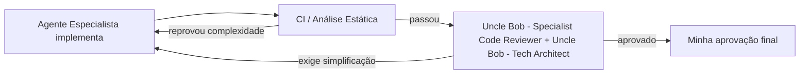

# Quando os agentes escrevem o código, o que você ainda precisa saber?

Agentes de IA não sentem dor ao editar um arquivo com 15 componentes espremidos em uma linha só e cheio de ramificações. Eles continuam adicionando features ali dentro sem reclamar. Quem sente a dor é você, quando o CI trava ou quando precisa depurar um incidente de madrugada num trecho que nunca escreveu à mão.

Essa reflexão veio do artigo [Here Be Monsters: What Do You Still Need to Know When Agents Do the Work?](https://blog.adrq.dev/here-be-monsters-what-do-you-still-need-to-know-when-agents-do-the-work), que bateu direto na forma como organizo a minha squad de agentes de IA para construir o Bargainly e um app de finanças para casais. *(Nota: quem são os agentes da minha squad e qual o papel de cada um está em [Apresentando o squad](/artigos/apresentando-o-squad.html) e em [Por que troquei um assistente de IA por uma squad de agentes especializados](/artigos/squad-de-agentes-especializados.html) — os nomes, como `Uncle Bob - Tech Architect` ou `Jordan Walke - Specialist React`, são personas inspiradas em referências da área apenas para dar identidade a cada função, sem qualquer envolvimento das pessoas reais.)*

## O alerta do SonarQube que abriu a discussão

No relato original, o autor conta que o CI quebrou de forma inesperada. Não era teste falhando nem dependência quebrada: era o SonarQube barrando o `App.tsx` por **complexidade ciclomática**.

Ao abrir o arquivo, a surpresa: cerca de 30 linhas, sendo que 15 delas eram componentes inteiros que o agente escreveu em uma única linha cada, misturando exibição e regra de negócio. O código estava funcionalmente correto e cobria os casos de borda, mas era um bloco denso que nenhum dev humano manteria daquele jeito. Bastou pedir para o agente satisfazer o SonarQube e ele fatiou a lógica em 10 arquivos limpos.

O ponto central do autor é certeiro: **ser dono de um sistema vai depender cada vez menos de ter digitado cada linha à mão, e cada vez mais de saber o suficiente para perceber quando algo está errado — e conseguir mergulhar fundo quando for preciso.**

## Por que agentes criam "mansões mal-assombradas" se ninguém vigiar

Quando um humano escreve código difícil de ler, ele mesmo sofre na próxima tarefa. Esse atrito natural funciona como freio.

O agente não tem esse freio. Para o modelo, iterar em cima de uma função com complexidade ciclomática alta custa quase o mesmo que iterar em código modular. Se o seu único critério de aceite for "a tela abriu e o teste passou", a base de código vai virando uma mansão improvisada, cheia de corredores escondidos.

Na minha squad, resolvi não confiar na boa vontade do agente que implementa. Dividi a responsabilidade em camadas:

- **Quem implementa foca na entrega:** o **Jordan Walke - Specialist React**, o **Ryan Dahl - Specialist Node** e o **James Gosling - Java Champion** constroem as features nos seus respectivos escopos.
- **Quem arquiteta barra complexidade desnecessária antes:** o **Uncle Bob - Tech Architect** não escreve código de produção; ele questiona a abordagem, compara alternativas e puxa sempre para o desenho mais simples.
- **Quem revisa lê só o diff com lupa:** todo PR passa pelo **Uncle Bob - Specialist Code Reviewer** e pelo **Linus Torvalds - Specialist Security** antes do meu ok, barrando funções acopladas ou componentes inchados antes do merge.
- **O CI é o freio mecânico:** a **Shannon Lietz - DevSecOps** mantém os checks automatizados nos pipelines de GitHub Actions. Linter, tipagem e análise estática não têm conversa: se o portão barra, o agente precisa refatorar antes de pedir minha aprovação.

## Os 3 pilares para continuar sendo dono do código

O artigo da fonte resume o papel do engenheiro que lidera agentes em três pilares que venho praticando todos os dias:

1. **Fundamentos:** estruturas de dados, concorrência, rede, banco de dados. Quando o agente resolve um problema com uma busca quadrática ou cria um gargalo de consultas, o sintoma começa silencioso. Sem fundamento, você acha que "a nuvem está lenta"; com fundamento, você sabe qual pergunta fazer para o **Vlad Mihalcea - Specialist DB**.
2. **Amplitude (mapa das águas):** você não precisa decorar cada linha de cada módulo, mas precisa ter o mapa mental da arquitetura na cabeça para saber onde os monstros moram e qual camada de abstração está vazando.
3. **Profundidade *just-in-time*:** a disposição de vestir o escafandro, abrir o código que o agente gerou, entender a causa-raiz e redesenhar a peça quando os próprios agentes entram em loop tentando consertar o que quebraram.

## O que fica para o meu fluxo

Delegar a digitação para uma squad de agentes não diminui a exigência técnica de quem está no comando — ela muda o tipo de exigência. Menos tempo decorando sintaxe repetitiva; muito mais rigor em limites arquiteturais, métricas estáticas no CI e capacidade de descer ao nível do código quando o alarme toca.

E por aí: você já colocou limites automáticos de complexidade para o código que seus agentes escrevem, ou só descobre quando precisa dar manutenção?
