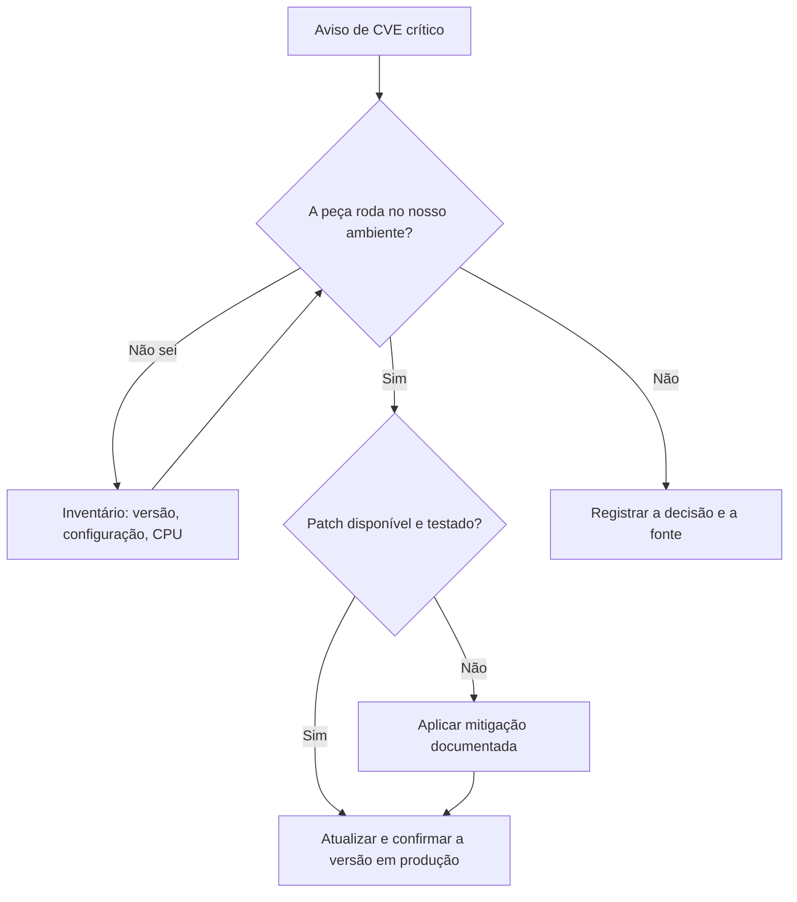

# Duas RCEs na mesma semana: o que o NGINX e o Java4Shell ensinam à minha squad

Na terça, 17 de novembro, a Calif publicou o Java4Shell, uma falha no decodificador Base64 do OpenJDK. Na quarta, 18, a F5 soltou a correção de duas falhas no HTTP/2 do NGINX, publicadas no mesmo dia pela Wiz. Nos dois casos dá para chegar a execução remota de código sem credencial, em peças que ficam no caminho de quase todo tráfego: o proxy da frente e o runtime de trás.

Escrevo como engenheiro que opera uma squad de agentes de IA. *(Nota: quem são os agentes da minha squad e qual o papel de cada um está em [Apresentando o squad](/artigos/apresentando-o-squad.html) e em [Por que troquei um assistente de IA por uma squad de agentes especializados](/artigos/squad-de-agentes-especializados.html). Os nomes são personas inspiradas em referências da área, usadas só para dar identidade a cada função, sem qualquer envolvimento das pessoas reais.)* Não relato um incidente meu. Leio o que foi publicado e levo o que dá para aplicar amanhã.

## NGINX: duas falhas no HTTP/2

A Wiz descreve duas falhas de memória no tratamento de HTTP/2. Segundo o post, elas foram achadas de forma independente pela Wiz, Ikotas Labs, Metnir, Rapid7 e Xint.

- **CVE-2026-123633**, um *use-after-free*: a conexão HTTP/2 entra na lista de conexões que o NGINX pode fechar quando precisa de espaço e não sai dela quando uma requisição começa. Se os `worker_connections` estão acabando e o NGINX está fazendo proxy para um backend, ele pode liberar a memória de uma conexão que ainda está em uso. Afeta da 1.19.7 à 1.31.8.
- **CVE-2026-123007**, um *integer underflow* na conta da janela de envio (`send_window`): um cancelamento devolve “crédito” sem checar o máximo, a checagem seguinte dá a volta no inteiro sem sinal e o resultado vira uma cópia de memória fora dos limites. Afeta da 1.9.5 à 1.31.8, ou seja, está no código desde 2015. A Wiz diz ter executado código com bypass de ASLR nos builds oficiais 1.31.7 e 1.31.8, com HTTP/2 sobre TLS em 64 bits, servindo só arquivo estático, sem backend nem módulo de terceiros.

A nota da F5 nos dois CVEs é 9.2 (crítica) em CVSS 4.0 e 8.1 (alta) em CVSS 3.1, com complexidade de ataque alta. O texto da F5 no NVD diz que a execução de código depende de ASLR desligado ou de um bypass; a Wiz afirma que as duas falhas dão leitura de memória antes, o que derruba essa proteção. A página de avisos do nginx.org classifica a 123007 como *major* e a 123633 como *medium*. A correção está nas versões 1.30.7 (estável) e 1.31.9 (mainline), e o mesmo pacote fechou outras falhas, como um *use-after-free* no HTTP/3 e outro no resolver de DNS.

Se não der para atualizar logo, a recomendação da Wiz é desligar o HTTP/2 por enquanto: `http2 off;` nos blocos afetados (a partir da 1.25.1) e tirar o parâmetro `http2` das diretivas `listen`, recarregar e confirmar que os workers antigos saíram.

## Java4Shell: o Base64 que escreve onde não devia

O CVE-2026-114938 fica no código otimizado que o OpenJDK usa para decodificar Base64 em processadores x86-64 com AVX-512 VBMI. Segundo a Calif, uma entrada malformada, como 64 caracteres `A` seguidos de um `=`, faz a rotina calcular um tamanho negativo e escrever 62 bytes além do fim do array. O Java acaba rejeitando a entrada, mas a essa altura a memória vizinha pode já ter sido corrompida. Com trabalho de exploração, isso vira vazamento de memória no estilo Heartbleed ou execução remota.

A Calif diz ter demonstrado execução remota sem autenticação, na configuração padrão, em Keycloak, Jira, Confluence, Artifactory, Jenkins e PingFederate, e com autenticação em Kafka, Solr, Elasticsearch, Gerrit e Spinnaker. Também cita um caminho do lado do cliente: um programa Java que abre TLS para um servidor malicioso pode ser comprometido mesmo sem expor serviço nenhum. A própria Calif avisa que não existe exploit universal, porque cada aplicação usa o Base64 de um jeito.

Sobre a nota, vale um cuidado. O 9.2 é a avaliação da Calif em CVSS 4.0. O aviso do OpenJDK e o da Oracle, que é quem atribuiu o CVE, dão 8.1 (alta) em CVSS 3.1, também com complexidade alta. O OpenJDK marca como afetadas as linhas 17, 21, 25 e 27; a Calif fala em “17.0.6 ou mais novo”, e distribuições como Corretto, Temurin, Zulu e Microsoft Build of OpenJDK herdam o problema. Processadores ARM64 não são afetados. A correção saiu em 17 de novembro, e as mitigações citadas pela Calif são subir a JVM com `-XX:-UseBASE64Intrinsics` ou, só em x86-64, com `-XX:UseAVX=2`.

O detalhe que mais me pegou: o bug foi relatado em público em junho, por alguém que bateu nele em produção. Em setembro já havia prova de conceito e uma correção proposta no OpenJDK, e esse PR foi fechado sem merge. A correção só saiu depois que a Calif mostrou que dava para explorar.

## O que as duas têm em comum

As duas são falhas de memória em código que a maioria de nós trata como chão firme. Ninguém escreve o HTTP/2 do proxy nem o assembly do Base64. Herda.

As duas também foram achadas com IA. A Wiz diz ter usado o próprio harness de análise de código e modelos de linguagem para validar o impacto. A Calif conta que o Codex achou o bug do Base64 em cerca de uma hora, que o primeiro exploit levou mais duas e que o custo em tokens ficou abaixo de US$ 200. A Wiz resume: a complexidade deixou de ser barreira para descobrir e explorar, e a janela entre a divulgação e a exploração tende a encurtar.

Para quem opera uma squad de agentes, isso corta para os dois lados. A mesma capacidade que eu uso para revisar e corrigir código está disponível para quem lê o diff de um patch procurando o caminho de volta. Já escrevi que [atualizar o pacote é a parte fácil](/artigos/supply-chain-rotacao-segredos.html). Aqui a parte difícil vem antes: saber, rápido, onde a peça vulnerável roda.

## O que eu levo para o fluxo

São práticas que recomendo e procuro seguir.

1. **Inventário antes do alarme.** Para o NGINX, a pergunta é qual versão roda, se o HTTP/2 está ligado e se ele faz proxy. Para o Java4Shell, é qual JDK, em que CPU e se é ARM ou x86-64 com AVX-512. Sem essa resposta pronta, a nota do CVE não ajuda a priorizar nada.

2. **Ter a mitigação escrita antes do patch.** Desligar o HTTP/2 ou subir a JVM com uma flag são mudanças pequenas, mas têm efeito colateral. Se um agente vai propor essa mudança, ela precisa de teste e de alguém que confirme que os workers antigos saíram ou que a JVM subiu com a flag certa.

3. **Ler a nota com o vetor ao lado.** O mesmo bug aparece como 9.2 numa fonte e 8.1 em outra, porque são versões diferentes do CVSS e avaliadores diferentes. Prefiro registrar as duas e a fonte de cada uma do que deixar um número só decidir a prioridade.

4. **Imagem e dependência herdada também são superfície.** O NGINX pode estar dentro de um ingress ou de uma imagem base; o JDK, dentro de uma ferramenta que nem é “nossa”, como um Jenkins ou um Keycloak. O agente que atualiza dependência do projeto não enxerga isso sozinho.

5. **Bug relatado não é bug corrigido.** O Base64 ficou meses com relato público e PR fechado. Quando um agente da squad abre um PR de correção de segurança, eu quero acompanhar até o merge e a versão publicada, não até o PR aberto. É o mesmo ponto de [O merge levou o PR, mas não a correção](/artigos/o-merge-levou-o-pr.html).

A Calif fecha o texto com uma pergunta que eu quero levar para a squad: com IA, todo mundo pergunta o que dá para construir, mas talvez a pergunta de segurança seja o que dá para apagar. Um decodificador em assembly para processar algumas centenas de bytes é exatamente o tipo de código que ninguém pediu e todo mundo carrega.

E na sua esteira, quanto tempo leva para responder “isso roda aqui?” quando sai um CVE desses?

## Fontes

- Wiz Research — [Unauthenticated Remote Code Execution in NGINX: CVE-2026-123633 and CVE-2026-123007](https://www.wiz.io/blog/nginx-http2-rce-vulnerabilities), de Nir Ohfeld e Tomer Schwartz, 18/11/2026
- nginx.org — [nginx security advisories](https://nginx.org/en/security_advisories.html) (versões afetadas e corrigidas, classificação de severidade)
- NVD — [CVE-2026-123633](https://nvd.nist.gov/vuln/detail/CVE-2026-123633) e [CVE-2026-123007](https://nvd.nist.gov/vuln/detail/CVE-2026-123007), com a descrição e as notas CVSS da F5, publicados em 18/11/2026
- Calif — [Java4Shell: Write once, RCE everywhere](https://calif.io/java4shell/), de Quang Luong, 17/11/2026 (linha do tempo adicionada em 19/11)
- OpenJDK — [OpenJDK Vulnerability Advisory: 2026/11/17](https://openjdk.org/groups/vulnerability/advisories/2026-11-17)
- Oracle — [Critical Security Patch Update Advisory - November 2026](https://www.oracle.com/security-alerts/cspunov2026.html)
- NVD — [CVE-2026-114938](https://nvd.nist.gov/vuln/detail/CVE-2026-114938), publicado em 17/11/2026
- Artigos deste blog citados no texto: [Atualizar o pacote é a parte fácil](/artigos/supply-chain-rotacao-segredos.html), [O merge levou o PR, mas não a correção](/artigos/o-merge-levou-o-pr.html)
