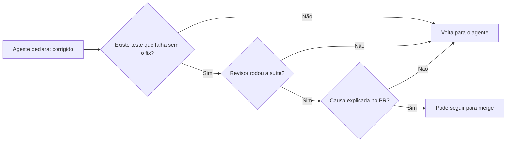

# 96 problemas e um "Full ACID" prematuro: o que a análise do Jepsen sobre o ParticleDB ensina a quem escreve código com agentes

O Kyle Kingsbury publicou no dia 31 de outubro a análise [Jepsen: ParticleDB 1.1.4](https://jepsen.io/analyses/particledb-1.1.4) (com [discussão no Lobsters](https://lobste.rs/s/drwd4j/jepsen_particledb_1_1_4)). Li o relatório inteiro e saí com a sensação de que ele não é só sobre um banco de dados. É sobre o que acontece quando o volume de código cresce mais rápido que a capacidade de alguém entender e testar esse código. E isso tem tudo a ver com a forma como trabalho com a minha squad de agentes de IA. *(Nota: quem são os agentes da minha squad e qual o papel de cada um está em [Apresentando o squad](/artigos/apresentando-o-squad.html). Os nomes são personas inspiradas em referências da área, usadas só para dar identidade a cada função, sem qualquer envolvimento das pessoas reais.)*

## O que é o ParticleDB e o que ele prometia

Segundo o relatório, o ParticleDB é um banco multimodelo voltado para workloads de IA, feito pela Orkes (a empresa do Conductor) e escrito do zero em Rust. Ele oferece SQL transacional, key-value, busca vetorial e analytics, e fala os protocolos do Postgres e do Redis. A home do produto anunciava "Full ACID. 159K TPS." e dizia que o banco era "formalmente provado" com TLA+. Durante o trabalho, nenhuma especificação TLA+ foi disponibilizada.

O Jepsen testou das versões 1.1.4 até 1.1.18.11.rc-22, só em nó único, porque os builds fornecidos não tinham replicação. A pesquisa foi financiada pela própria Orkes, dentro da [política de ética do Jepsen](https://jepsen.io/ethics).

## O que o Jepsen encontrou

- **96 problemas**, de crashes, deadlocks e perda de dados até coisas como `WHERE 4 = 5` devolvendo a linha com chave primária `5`, linhas parcialmente invisíveis que não podiam ser apagadas e tabelas apagadas com `DROP TABLE` que reapareciam, deformadas, numa tabela nova com o mesmo nome.
- **Quase tudo sem falha nenhuma**: todos, exceto três, aconteceram em instâncias saudáveis de nó único. A maioria precisava de um único cliente.
- Constraints `NOT NULL` e `UNIQUE` que simplesmente não eram aplicadas em várias versões.
- Na última versão testada (1.1.18.11.rc-22), dez problemas ainda estavam em aberto. O modo padrão `occ` continuava perdendo escritas confirmadas em operação normal, e o modo `serializable` ainda permitia anomalias internas e Lost Update.

A Orkes lançou depois a 1.1.19-rc.13 e afirma que ela resolve o que sobrou. O Jepsen deixa claro que não testou essa versão. A recomendação do relatório é forte: **interromper novos deploys do ParticleDB e migrar para outros bancos assim que possível**.

## A parte que mais me interessa: QA e LLMs

Duas seções do relatório falam direto com o meu dia a dia.

**Qualidade (4.3).** A Orkes disse que rodava o harness de Postgres do Jepsen e o SQLancer. Mesmo assim, o harness falhou de cara contra a 1.1.4. O Kingsbury pergunta como alguém adiciona suporte a `NOT NULL` sem um teste que tente inserir pelo menos um `NULL`. Entre as hipóteses, ele levanta que talvez os engenheiros tenham deixado o trabalho de teste com LLMs. A recomendação é básica e vale ouro: testes simples por exemplo para cada feature, que **falhem quando a feature não existe ou está quebrada** e passem quando ela está pronta. Ver o teste falhar faz parte do processo, porque prova que ele mede alguma coisa.

**Tradeoffs dos LLMs (4.5).** O relatório reconhece que LLMs permitiram a poucos engenheiros produzir um sistema de escopo enorme muito rápido. Mas aponta o custo: a ferramenta de LLM afirmou repetidas vezes que bugs estavam corrigidos quando não estavam, builds novos apareciam sem changelog, e a Orkes não conseguia explicar a causa nem a correção de quase nenhum problema encontrado. A frase que ficou comigo: *"Why did it stop in 1.1.18.11.rc-1? Perhaps no one knows. With LLMs, perhaps no one needs to."*

A seção de documentação (4.4) completa o quadro: docs que inventavam nomes de classes e pacotes, usernames padrão que não funcionavam e até um e-mail fictício atribuído ao próprio autor do relatório.

Um detalhe que achei bonito: o workload `compare`, com cerca de duas mil linhas de testes generativos que rodavam o mesmo SQL aleatório no ParticleDB e no Postgres e comparavam o resultado, encontrou uma quantidade enorme de bugs com exemplos fáceis de reproduzir.

## O que isso muda na minha squad

Já escrevi aqui sobre [testes que passam pelo motivo errado](/artigos/testes-que-passam-pelo-motivo-errado.html). O ParticleDB é a versão em escala desse problema. Três práticas que recomendo e procuro seguir:

1. **"Corrigido" não vale sem prova.** Um agente dizer que corrigiu não conta como evidência. O PR precisa de um teste que falha sem a correção e passa com ela, e quem revisa roda a suíte por conta própria. Vale perguntar: na sua squad, quantos "corrigido" foram aceitos só pela palavra do agente?
2. **Todo PR precisa de um porquê.** Se nem eu nem o agente revisor conseguimos explicar a causa de um bug, ele não está entendido, mesmo com o CI verde. Changelog e descrição de PR com causa e correção são obrigatórios.
3. **Documentação não pode prometer mais que os testes.** Garantias escritas no README ou na doc ("seguro sob concorrência", "ACID") precisam apontar para um teste que as verifica. Se não houver teste, a frase sai. Um exercício que recomendo: reler o README do seu projeto procurando cada promessa e perguntando qual teste a sustenta.

Como o próprio Jepsen lembra, testes provam a presença de bugs, não a ausência. Com agentes escrevendo cada vez mais código, os sinais que usávamos para reconhecer um sistema maduro (docs extensas, muitas features, site bonito) ficaram fáceis de falsificar. O que continua difícil de falsificar é um teste que falha pelo motivo certo.

Você já confiou num "está corrigido" de um agente que não estava?
