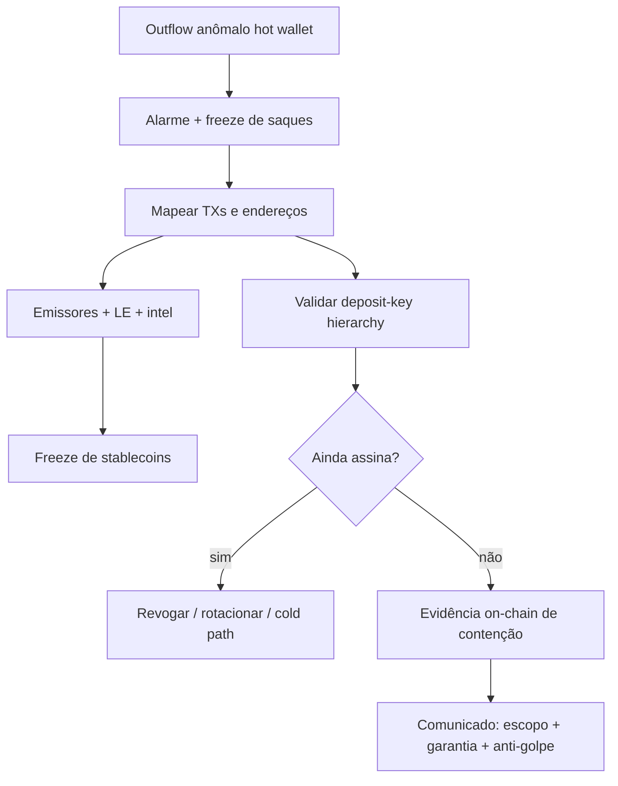

# O ataque ao Mercado Bitcoin: hot wallets, contenção e o que a blockchain ainda não explica

Quatro dias depois do incidente da Binance, na madrugada de **2 de novembro de 2026**, o Mercado Bitcoin — a maior exchange de criptomoedas do Brasil — sofreu um ataque que esvaziou **carteiras quentes**. Li o comunicado da corretora, o relato da Chainalysis e as análises on-chain da Bitquery e da Paradigma Education (via imprensa) com a mesma pergunta que faço em todo post-mortem externo: o que disso eu consigo aplicar amanhã, sem inventar causa raiz que a empresa ainda não publicou?

Escrevo em primeira pessoa, como faço nos outros artigos deste blog, e levo as lições para a minha squad. *(Nota: quem são os agentes da minha squad e qual o papel de cada um está em [Apresentando o squad](/artigos/apresentando-o-squad.html) e em [Por que troquei um assistente de IA por uma squad de agentes especializados](/artigos/squad-de-agentes-especializados.html) — os nomes, como `Linus Torvalds - Specialist Security` e `Shannon Lietz - DevSecOps`, são personas inspiradas em referências da área apenas para dar identidade a cada função, sem qualquer envolvimento das pessoas reais.)*

## O que o Mercado Bitcoin confirmou

Na [atualização oficial de 2 de novembro de 2026, às 21h](https://central.ajuda.mercadobitcoin.com.br/wiki/spaces/TF/pages/2965700610), o MB afirmou o essencial para o cliente:

- Houve um **incidente de segurança** na madrugada; a plataforma foi tirada do ar; autoridades foram notificadas.
- O ataque atingiu **apenas as carteiras quentes** (hot wallets) usadas no dia a dia de saques e depósitos — o “caixa da loja”. A maior parte dos ativos, segundo a corretora, permanece em carteiras frias (cold).
- Com parceiros (Tether, Circle, BRL1, Paxos e Chainalysis), a empresa disse ter bloqueado cerca de **US$ 11 milhões**; o valor ainda não bloqueado, naquele e-mail/atualização, era cerca de **US$ 38 milhões** (somados, cerca de **US$ 49 milhões** — ordem de grandeza também citada no e-mail aos clientes reportado pelo [WB3News](https://wb3news.com.br/noticia/ataque-hacker-mercado-bitcoin-49-milhoes)).
- Garantia: clientes **não perderão ativos** por causa do incidente.
- Alerta explícito contra golpes de follow-up: a corretora não pede senha, código ou frase de recuperação por WhatsApp/ligação, nem oferece reembolso por link.

Em **4 de novembro de 2026**, o [Valor Econômico](https://valor.globo.com/financas/criptomoedas/noticia/2026/11/04/aps-ataque-hacker-mercado-bitcoin-reabre-acesso-gradual-a-contas-a-partir-de-2-feira.ghtml) noticiou, a partir de comunicado do MB, que o incidente envolveu **US$ 49,2 milhões**, que já haviam sido bloqueados **mais de US$ 15 milhões**, e que a reabertura seria gradual a partir de **9 de novembro** (site em modo consulta); saques e negociação ainda sem prazo definido, cobertos com recursos próprios.

No [FAQ público do MB](https://central.ajuda.mercadobitcoin.com.br/wiki/spaces/TF/pages/2968387585/Perguntas+Frequentes), a corretora também afirma que, “neste momento”, o valor dos ativos envolvidos é de cerca de **US$ 36,3 milhões** (com mais de US$ 15 milhões já bloqueados). Essa página **não exibe data de atualização verificável**; trato a cifra como estava nos **dados apurados até 05/11/2026**, em paralelo às estimativas anteriores do próprio MB e da Bitquery — não como correção que invalida os snapshots de 2–4/11.

## Números: mesma história, rótulos diferentes

**Dados apurados até 05/11/2026.** Cifras mudam com cotação, freezes e releituras on-chain; estimativas anteriores **não são “falsas”** — são snapshots com data e método. Cada linha abaixo leva emissor e data.

### Contagens Bitquery atualizadas em 5/11/2026

A investigação da [Bitquery](https://bitquery.io/investigations/mercado-bitcoin-hack) (figuras on-chain verificadas em **5 de novembro de 2026**) separa três escopos que eu não misturo:

1. **Hot wallets do MB — 10 blockchains.** Na madrugada de 2/11, em cerca de 25 minutos, as carteiras quentes do MB em **10** redes pagaram o atacante (Bitquery FAQ / seção “The night”).
2. **Total atribuído ao MB — US$ 48,6 milhões em 11 blockchains.** O total de **US$ 48,6M** cobre **11** redes com perdas ligadas ao Mercado Bitcoin (hot wallets + varreduras adicionais de depósito em cadeias além do núcleo das 10). Inclui a varredura de endereços de depósito (ex.: 36.042 endereços ETH esvaziados entre 12:27 e 16:56 UTC, cerca de US$ 266 mil no agregado ETH; sweeps também em BNB Chain e Base, segundo a Bitquery).
3. **Endereço do atacante em 17 blockchains (MB + BitMart).** A Bitquery vê o mesmo endereço do atacante em **17** cadeias no total — o mesmo número que a Chainalysis citou para “este hack”. **Só 11** dessas 17 mostram perdas do Mercado Bitcoin; o restante concentra, na leitura da Bitquery, perdas ligadas à **BitMart** (~**US$ 424 mil**, atualizado em 5/11; BitMart confirmou ter sido hackeada, sem publicar a cifra).

Freeze on-chain na mesma atualização Bitquery: cerca de **US$ 11,8 milhões** congelados por emissores (maioria Tether, Circle e Paxos).

### Outras estimativas (snapshots anteriores ou de outros emissores)

| Número | Fonte e data | Nota |
|---|---|---|
| ~US$ 49 milhões | [Chainalysis, 2/11/2026](https://www.chainalysis.com/blog/chainalysis-response-mercado-bitcoin/) | “approximately $49 million”; blog também fala em ativos em **17** blockchains (escopo do atacante / ondas) |
| US$ 49 milhões / ~R$ 267 milhões | E-mail MB aos clientes (WB3News, 3/11/2026) | ~US$ 11M bloqueados + ~US$ 38M ainda não, naquele momento |
| US$ 49,2 milhões | Valor citando atualização do MB, 4/11/2026 | Snapshot da corretora via imprensa |
| US$ 48,5–48,6 milhões / “10 blockchains” | Bitquery via WB3News (3/11) e [CoinDesk, 5/11/2026](https://www.coindesk.com/pt-br/business/2026/11/05/mercado-bitcoin-hack-continued-hours-after-exchange-said-attack-was-contained-report-finds) | Leituras anteriores/intermediárias; a atualização Bitquery de 5/11 consolida **US$ 48,6M / 11 redes** para o MB |
| ~US$ 40 milhões | Alertas iniciais Hypernative (via WB3News) | Primeiro alerta público |
| US$ 45,1 milhões | Paradigma Education (hot wallets; via WB3News) | Escopo hot wallets |
| ~US$ 11 milhões bloqueados | MB Central, 2/11 ~21h | |
| nearly US$ 10 milhões / ~US$ 10,5 milhões on-chain | Chainalysis; levantamento WB3News (3/11) | Métodos e horários diferentes |
| > US$ 15 milhões bloqueados | Valor / comunicado MB, 4/11/2026; FAQ MB | Atualização posterior da corretora |
| ~US$ 391 mil (BitMart) | Bitquery/CoinDesk em leituras anteriores a 5/11 | Substituído na Bitquery 5/11 por ~**US$ 424 mil** — não chamo o 391k de erro; era contagem parcial |
| **~US$ 36,3 milhões** | [FAQ do MB](https://central.ajuda.mercadobitcoin.com.br/wiki/spaces/TF/pages/2968387585/Perguntas+Frequentes) (“Neste momento… cerca de US$ 36,3 milhões”) | Página **sem data de atualização verificável** no HTML público; cito como estava **nos dados apurados até 05/11/2026**, não como cifra definitiva |

A Chainalysis descreveu que, nas primeiras horas de 2 de novembro, o atacante moveu ativos em ondas e que a maior parte veio de Bitcoin e Ethereum, com varredura também em redes menores (Base, Tron, Polygon, entre outras citadas no blog).

## Linha do tempo (horário de Brasília, via WB3News / Hypernative / Bitquery)

- **1/11 ~23:15** — primeiras movimentações suspeitas em endereços antigos de depósito em bitcoin (Hypernative).
- **2/11 03:19–03:53** — bloco principal; hot wallets enviam ao atacante cerca de 03:24–03:50 (Hypernative / Bitquery).
- **03:41** — transação de cerca de **104,43 BTC** esvazia a hot wallet de bitcoin (mempool.space via WB3News).
- Manhã — freezes começam (Tether, Paxos etc., conforme Bitquery/WB3News).
- **09:56 (Brasília)** — MB anuncia identificação/contenção e suspende depósitos/saques (~12:56 UTC).
- **12:27–16:56 UTC** — na atualização de **5/11**, a [Bitquery](https://bitquery.io/investigations/mercado-bitcoin-hack) registra 36.042 endereços de depósito ETH esvaziados **depois** do anúncio de contenção (~12:56 UTC); sweeps adicionais em BNB Chain e Base. O [CoinDesk de 5/11](https://www.coindesk.com/pt-br/business/2026/11/05/mercado-bitcoin-hack-continued-hours-after-exchange-said-attack-was-contained-report-finds) ecoa essa janela. Isso não prova má-fé; prova que “contido” no comunicado e “contido” on-chain podem divergir por horas. (Leituras iniciais via WB3News falavam em início ~09:10 Brasília; a Bitquery corrigiu spam look-alike e consolidou a janela UTC acima.)
- Noite de 2/11 — updates oficiais / e-mail com garantia ao cliente e cifras de freeze.

## Vetor de ataque: o que é fato e o que é hipótese

**Confirmado pelo MB:** o incidente atingiu carteiras quentes; cold storage, segundo a corretora, não foi o alvo daquele comunicado.

**Ainda não publicado pelo MB (até as fontes desta pesquisa):** a porta de entrada — credenciais, provedor de custódia, insider, malware, etc. **Não invento.**

**Hipótese de pesquisadores on-chain** (Bitquery e Paradigma Education, reportadas pelo [WB3News](https://wb3news.com.br/noticia/ataque-hacker-mercado-bitcoin-49-milhoes); Hypernative: transferências simples, não exploit de smart contract):

- As saídas das hot wallets teriam perfil compatível com o **próprio sistema de construção de saques** da corretora (template de transação BTC, escala de fees típica).
- A varredura de endereços de depósito, cada um assinando a própria transferência, sugere possível acesso a chaves derivadas de uma hierarquia/master key — padrão comum em exchanges, segundo a Bitquery; a blockchain sozinha **não prova** a hipótese.
- Hypernative e Bitquery registram que **como** o atacante obteve autorização ainda não estava claro.

Trato essas análises como **hipótese fundamentada em indícios**, não como causa raiz oficial.

Sobre a proximidade com o hack da Binance (quatro dias antes): o WB3News registra que Hypernative e o MB **não** estabeleceram associação entre os dois ataques. Não atribuo o mesmo ator sem fonte.

## Resposta a incidente que funcionou em parte

O [blog da Chainalysis de 2/11](https://www.chainalysis.com/blog/chainalysis-response-mercado-bitcoin/) descreve mobilização Hour 0: mapa de TXs não autorizadas, contato com autoridades e emissores de stablecoins, freezes nas primeiras horas (a Chainalysis fala em nearly US$ 10 milhões ajudados a congelar no texto do blog). A Paradigma, citada pelo WB3News, contextualizou que recuperar na casa de ~20%+ no primeiro dia é resultado forte frente a médias históricas baixas — mas isso é comentário de terceiros, não métrica do MB.

Do lado do cliente, a comunicação precoce de escopo (hot vs cold) e da garantia de cobertura importa tanto quanto o freeze técnico. O alerta anti-golpe no mesmo comunicado é detalhe de IR que times costumam esquecer.

## Lições para engenheiros

Levo isto para checklist da squad — de novo com olhar do **Linus Torvalds - Specialist Security** e da **Shannon Lietz - DevSecOps**.

### Hot wallet
Trate hot wallet como caixa com teto e sirene. Outflow com valor quebrado atípico, muitas inputs e destino em formato/endereço fora do padrão histórico (sinais que a Paradigma apontou no caso BTC, via WB3News) deveria disparar contenção automática *antes* do anúncio humano.

### Contenção declarada ≠ contenção on-chain
Se a hierarquia de chaves de depósito estiver comprometida, o atacante pode continuar esvaziando *deposit addresses* horas depois do “já contivemos”. O CoinDesk/Bitquery documentam essa janela. No runbook: validar contenção com evidência on-chain e com inventário de quais chaves ainda assinam.

### Deposit keys / master key
Se uma seed ou master key gera todos os endereços de depósito, o blast radius é a frota inteira. Segmentação, rotação e limites por família de chaves deixam de ser “hardening teórico” depois de um incidente como este.

### Signing e caminho de saque
Mesmo sem causa raiz oficial, o caso reforça: quem controla o software que **monta** a transação de saque controla o caixa. Separar identidades de construção de TX, aprovação e broadcast; auditar templates e políticas de fee.

### Social engineering e supply chain
Aqui o MB ainda não publicou vetor de entrada. Mesmo assim, o contexto da semana (Binance com entrevistas falsas e tooling de AI adulterado) é lembrete: processos de pessoas e de dependências entram no mesmo threat model da custódia. Não misturo os dois casos sem evidência; uso o da Binance como checklist paralelo, não como atribuição.

### Resposta a incidente
- Acionar emissores de stablecoin e blockchain intel na primeira hora muda taxa de freeze.
- Comunicar escopo (hot/cold) e garantia ao cliente cedo.
- Publicar causa raiz só com evidência; hipóteses de pesquisadores vão no texto com rótulo explícito.
- Antecipar golpes de “reembolso” no mesmo canal oficial.

## O que eu levo para a minha rotina

- Tabletop: “anunciamos contenção às 10h; às 15h ainda há deposit addresses assinando — o que o runbook manda fazer?”
- Inventário explícito de quem pode construir e quem pode aprovar um saque.
- Não misturar hipótese on-chain com statement oficial no mesmo parágrafo sem rótulo.

Na sua operação, você conseguiria provar em uma hora — com evidência on-chain ou de log — que a contenção realmente encerrou todas as chaves que ainda assinam?

## Fontes

- Mercado Bitcoin — [Atualização de 02/11, às 21h](https://central.ajuda.mercadobitcoin.com.br/wiki/spaces/TF/pages/2965700610)
- Mercado Bitcoin — [Perguntas frequentes](https://central.ajuda.mercadobitcoin.com.br/wiki/spaces/TF/pages/2968387585/Perguntas+Frequentes) (cifra ~US$ 36,3M; lida nos dados apurados até 05/11/2026; página sem data de update verificável)
- Bitquery — [Mercado Bitcoin Hack: $48.6M on 11 blockchains](https://bitquery.io/investigations/mercado-bitcoin-hack) (figuras on-chain verificadas 5/11/2026)
- Chainalysis — [Mercado Bitcoin Hack: response and freezes](https://www.chainalysis.com/blog/chainalysis-response-mercado-bitcoin/) (2/11/2026)
- Valor Econômico — [Após ataque hacker, Mercado Bitcoin reabre acesso gradual](https://valor.globo.com/financas/criptomoedas/noticia/2026/11/04/aps-ataque-hacker-mercado-bitcoin-reabre-acesso-gradual-a-contas-a-partir-de-2-feira.ghtml) (4/11/2026)
- WB3News — [Hacker do Mercado Bitcoin teria usado o próprio sistema de saques](https://wb3news.com.br/noticia/ataque-hacker-mercado-bitcoin-49-milhoes) (3/11/2026)
- CoinDesk — [Hack no Mercado Bitcoin continuou horas após contenção anunciada](https://www.coindesk.com/pt-br/business/2026/11/05/mercado-bitcoin-hack-continued-hours-after-exchange-said-attack-was-contained-report-finds) (5/11/2026)
