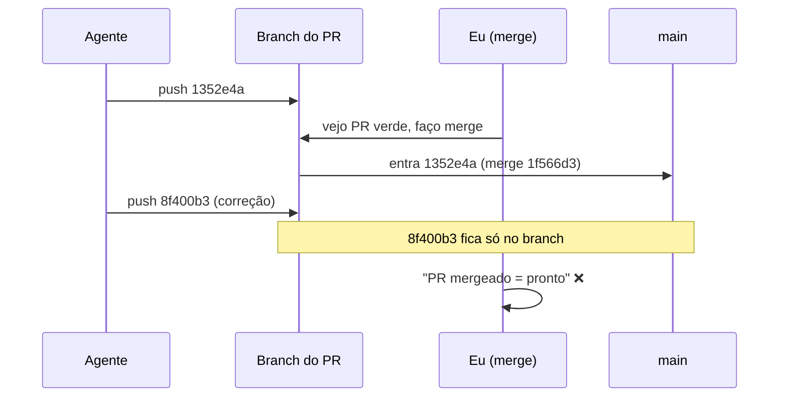

# O merge levou o PR, mas não a correção

Um PR mergeado não prova que a correção entrou. Prova só que **o commit que estava na cabeça do PR no momento do merge** entrou. Com agentes de IA fazendo push no mesmo branch, essas duas coisas se separam com facilidade. Para mim, "pronto" agora é uma pergunta com resposta verificável: **o SHA da correção está na `main`?**

Aconteceu duas vezes seguidas, em menos de meia hora, neste próprio blog.

## O que aconteceu

Na madrugada de 21/10/2026 eu estava redesenhando este site com a ajuda de um agente. O trabalho foi em três PRs. Os horários abaixo estão em horário de Brasília (UTC-3), tirados dos dados dos PRs e dos commits.

| Horário | Evento |
|---|---|
| 00:25 | Último commit do PR #3 na hora do merge: [`1352e4a`](https://github.com/ebersonra/post-mortem/commit/1352e4a8de75772031107f35747e16990314fcf9) |
| 00:28 | PR #3 mergeado na `main` (merge [`1f566d3`](https://github.com/ebersonra/post-mortem/commit/1f566d373957a1de0770804f5a8ec592addaf7e6)) |
| 00:38 | O agente faz push de [`8f400b3`](https://github.com/ebersonra/post-mortem/commit/8f400b3ce08c7b0ae737096d4eeab8f3111abc63) (correção de `/archive/` e contraste no tema escuro) **no branch do PR #3, que já estava mergeado** |
| 00:42 | A correção é reaplicada num branch novo como [`0122033`](https://github.com/ebersonra/post-mortem/commit/01220336fd15210bd004d6d64638081fe1f1b2ea), PR #4 |
| 00:43 | PR #4 mergeado (merge [`6c9c8ef`](https://github.com/ebersonra/post-mortem/commit/6c9c8ef0889773f14e3b14bf6add3590f2304960)), com um único commit |
| 00:47 | O agente faz push de [`a9a2ddc`](https://github.com/ebersonra/post-mortem/commit/a9a2ddc790ada5ed300406140682697f826d62d8) (tema visual de jornal) no branch do PR #4, já mergeado |
| 00:52 | PR #5 traz o tema de volta com cherry-pick ([`24866d5`](https://github.com/ebersonra/post-mortem/commit/24866d5)) e acrescenta a troca de marca ([`f99c990`](https://github.com/ebersonra/post-mortem/commit/f99c99060dc6935853c2a6395261cf0d532e35b8)) |
| 00:54 | PR #5 mergeado (merge [`0dd6216`](https://github.com/ebersonra/post-mortem/commit/0dd62163ba47836f7c11c41a554efab82b745e59)) |

O detalhe que mais me incomodou foi o PR #4. A descrição dele já falava do tema de jornal como parte das mudanças. O PR tinha um commit só, e esse commit não trazia o tema. **A descrição contava o trabalho que o agente planejava fazer, não o que estava no head do PR.** Quem olhasse só o texto acharia que estava tudo lá.

Nada quebrou em produção de forma grave. O problema foi mais sutil: por alguns minutos, cada vez, eu achei que algo estava entregue e não estava.

## Por que isso acontece com agentes

Num fluxo só com humanos, quem abre o PR costuma parar de mexer no branch quando pede review. Com um agente isso não é garantido. O agente trabalha em ciclos: implementa, verifica, ajusta e faz push de novo. Ele não sabe que o PR foi mergeado no meio do caminho, e o Git não impede um push num branch cujo PR já foi fechado.

O merge, por sua vez, é uma foto. O GitHub grava o `head.sha` daquele instante e pronto. O que chega no branch depois fica lá, órfão, com cara de trabalho concluído.



Três coisas se somaram:

1. **O merge foi rápido.** Em todos os três PRs o intervalo entre abrir e mergear foi de poucos minutos. Isso é ótimo para iterar, mas deixa pouco tempo entre o último push e o merge.
2. **O sinal de "pronto" era o estado do PR** (mergeado, checks verdes), e não o conteúdo da `main`.
3. **A descrição do PR foi usada como fonte de verdade.** Ela é escrita por quem abre o PR, e com um agente isso pode acontecer antes do código existir.

Ninguém errou de forma isolada. O processo media a coisa errada.

## O que mudei (ou vou mudar)

Meu critério de pronto agora é: **o SHA do último commit do agente é ancestral da `main`.** Na prática:

**1. Comparar o head do PR no merge com o último commit do agente.** Antes de considerar a tarefa entregue, confiro se o último SHA que o agente reportou é o mesmo `head.sha` que o PR tinha quando foi mergeado. Se forem diferentes, ficou trabalho para trás.

```bash
# o commit do agente está na main?
git fetch origin
git merge-base --is-ancestor <sha-do-agente> origin/main && echo "na main" || echo "FORA da main"
```

**2. Exigir novo review quando entram commits novos.** Ativar no repositório a opção de descartar aprovações quando chegam commits novos. Não resolve o push depois do merge, mas impede o caso parecido: aprovar uma versão e mergear outra.

**3. Mergear só quando o agente disser que parou.** O agente precisa informar explicitamente que terminou e qual é o SHA final. Merge acontece depois desse sinal, não quando o PR "parece pronto".

**4. Conferir na `main` e em produção, não no PR.** Para um site como este, isso quer dizer abrir a página publicada e ver a mudança, ou checar qual commit o deploy usou. Aqui no blog, no PR #6, o build do GitHub Pages terminou 42 segundos depois do merge, e o card já estava no ar em menos de 2 minutos. Ou seja, a janela para conferir é curta e barata.

**5. Tratar a descrição do PR como intenção, não como evidência.** O que conta é a lista de commits e o diff. Se a descrição cita algo que não está no diff, o PR não está pronto.

Ainda não automatizei nada disso. O próximo passo é um check simples que, depois do merge, avisa se o branch de origem recebeu commits que não estão na `main`.

## Lição

Com agentes, "o PR foi mergeado" e "a correção chegou" viraram afirmações diferentes. Só a segunda importa, e ela tem uma resposta objetiva: um SHA que está ou não está na `main`. Parei de perguntar "mergeou?" e passei a perguntar "qual SHA está na `main`, e é o último?".
