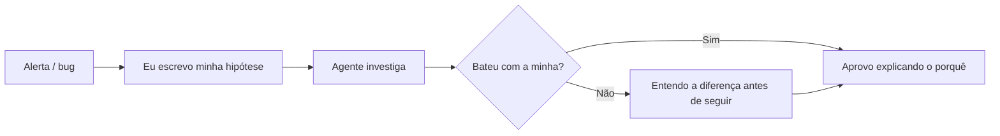

# A IA não está substituindo o SRE, está tirando a prática dele: o que isso muda na minha squad de agentes

Esta semana o texto [AI Isn't Replacing SREs. It's Deskilling Them.](https://newsletter.signoz.io/p/ai-isnt-replacing-sres-its-deskilling), da Elizabeth, da newsletter da SigNoz, [voltou a circular no Hacker News](https://news.ycombinator.com/item?id=50305693). A pergunta central dele me incomodou de um jeito bom: *quando a IA cuida de 95% da resposta a incidentes, você fica pior nos 5% que realmente importam?*

Eu não sou SRE de uma grande operação. Mas há algum tempo opero uma squad de agentes de IA especializados, e boa parte do trabalho operacional do meu dia (ler logs, levantar hipótese, revisar PR, rodar CI) passou a ser feita primeiro por eles. Então a pergunta vale para mim também. *(Nota: quem são os agentes da minha squad e qual o papel de cada um está em [Apresentando o squad](/artigos/apresentando-o-squad.html) e em [Por que troquei um assistente de IA por uma squad de agentes especializados](/artigos/squad-de-agentes-especializados.html). Os nomes são personas inspiradas em referências da área, usadas só para dar identidade a cada função, sem qualquer envolvimento das pessoas reais.)*

## As Ironias da Automação, de novo

O texto se apoia num artigo de 1983, *Ironies of Automation*, da psicóloga cognitiva Lisanne Bainbridge. O argumento, como o texto resume: quanto mais você automatiza um processo, mais crítico fica o operador humano nos raros momentos em que a automação falha. Só que ele pratica menos e fica pior justamente nessas intervenções. Sobra para o humano o pior trabalho possível: longos períodos de monitoramento passivo, interrompidos por crises raras e de alto risco.

A autora faz o paralelo com a IA no trabalho de conhecimento. A IA assume triagem, correlação de padrões e resolução de problemas conhecidos. Para o humano sobram os problemas raros, complexos e ambíguos, que exigem exatamente a experiência que atrofia quando você para de praticar.

## O modelo em camadas e o furo dele

O texto cita o modelo em camadas que a PagerDuty usa:

- **Tier 1:** problemas conhecidos com correção conhecida, totalmente automatizados.
- **Tier 2:** problemas parcialmente entendidos, com recomendação da IA e validação humana.
- **Tier 3:** falhas novas, complexas e em cascata, conduzidas por humanos com contexto da IA.

O furo aparece logo em seguida: se o humano só atua no Tier 3, onde ele constrói a intuição para lidar com ele? A intuição vem de anos de repetição nos incidentes "fáceis", que agora a máquina resolve.

## Deskilling e "never-skilling"

O texto cita dois exemplos de outras áreas: um estudo em que endoscopistas que usavam IA para detectar pólipos viram a taxa de detecção *sem* a IA cair de 28% para 22% depois de um período de uso, e a aviação, onde a FAA passou a exigir mais horas de voo manual para compensar a dependência do piloto automático.

Para mim, a parte mais perigosa é que **você não sente acontecer**. A perda aparece como hiperprodutividade. Você se sente competente, os dashboards estão verdes, e um dia chega um incidente que não bate com nenhum padrão.

E tem um segundo conceito, ainda pior: **never-skilling**. Deskilling é perder uma habilidade que você tinha. Never-skilling é nunca desenvolvê-la, porque quem entra na área hoje encontra a IA já fazendo o trabalho de base.

## Onde eu me reconheço nisso

O texto lista sintomas bem concretos: parar de ler logs crus porque a IA resume, parar de formular hipóteses porque a IA sugere a causa raiz, parar de montar o modelo mental da arquitetura porque a IA mapeia as dependências.

Eu me reconheço em pelo menos um deles. [EXPERIÊNCIA REAL: um momento concreto em que percebi que tinha delegado a leitura de logs ou o diagnóstico para um agente e fiquei sem saber o que estava acontecendo no sistema]

Na minha squad, quem implementa nunca aprova o próprio PR, e a revisão é feita por outro agente. Isso protege o código, mas também cria o cenário que a Bainbridge descreveu: eu viro o supervisor que aprova recomendações. O texto da SigNoz separa *human-in-the-loop* (o humano trabalha o problema junto com a IA) de *human-on-the-side* (o humano só aprova). É no segundo modo que a vigilância decai.

## O que estou mudando

As duas propostas do texto são **ineficiência deliberada** (separar alguns incidentes, mesmo os que a IA resolveria, como treino humano, do jeito que a FAA exige horas de voo manual) e **projetar para o humano no loop, não do lado**. Traduzi isso para três práticas:

1. **Hipótese antes do agente.** Antes de pedir diagnóstico a um agente, escrevo em uma linha qual acho que é a causa. Depois comparo. [MÉTRICA REAL: quantas vezes minha hipótese bateu com a do agente num período]
2. **Um incidente por [EXPERIÊNCIA REAL: período] sem atalho.** Pego um problema que o agente resolveria e investigo na mão: logs crus, métricas, código.
3. **Aprovar exige explicar.** Não aprovo um PR de agente sem conseguir explicar, com as minhas palavras, por que a correção funciona. Se não consigo, o PR volta com uma pergunta, não com um "LGTM".

Nada disso é rejeitar a IA. O próprio texto deixa claro que a adoção vai continuar e ficar mais forte. O ponto é usar a squad de um jeito que me mantenha afiado para os 5% que ela não resolve.

E você, já percebeu alguma habilidade sua enferrujando porque um agente passou a fazer por você?

## Fontes

- SigNoz — [AI Isn't Replacing SREs. It's Deskilling Them.](https://newsletter.signoz.io/p/ai-isnt-replacing-sres-its-deskilling), de Elizabeth
- Hacker News — [AI isn't replacing SREs, it's deskilling them](https://news.ycombinator.com/item?id=50305693)
- The Lancet Gastroenterology & Hepatology (via PubMed) — [Endoscopist deskilling risk after exposure to artificial intelligence in colonoscopy: a multicentre, observational study](https://pubmed.ncbi.nlm.nih.gov/40816301/), de Budzyń et al. (2025)
- FAA — [SAFO 13002: Manual Flight Operations](https://www.faa.gov/sites/faa.gov/files/other_visit/aviation_industry/airline_operators/airline_safety/SAFO13002.pdf) (2013)
- FAA — [SAFO 17007: Manual Flight Operations Proficiency](https://www.faa.gov/sites/faa.gov/files/2022-11/SAFO17007.pdf) (2017)
