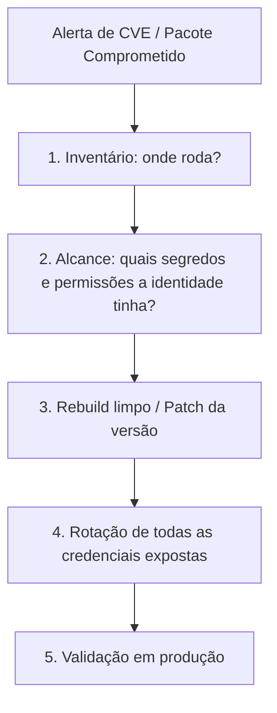

# Atualizar o pacote é a parte fácil: supply chain, LiteLLM e rotação de segredos

Quando sai um alerta crítico de segurança, a reação automática de qualquer time é perguntar: *"qual é a versão corrigida para eu abrir o PR de bump?"*. Mas, em incidentes de supply chain, atualizar a versão é só o começo. O trabalho real — e o que quase sempre atrasa — é saber exatamente onde aquilo rodou, o que aquela identidade podia alcançar e quais segredos precisam ser rotacionados.

Essa análise veio do artigo [PHP2Shell, LiteLLM, GitLab: Find What You Need to Patch](https://cloudsleuth.io/blog/php2shell-litellm-gitlab-find-what-you-run/), da Cloud Sleuth, que dissecou uma semana pesada de outubro de 2026 e reforçou várias regras que sigo com a minha squad de agentes de IA. *(Nota: quem são os agentes da minha squad e qual o papel de cada um está em [Apresentando o squad](/artigos/apresentando-o-squad.html) e em [Por que troquei um assistente de IA por uma squad de agentes especializados](/artigos/squad-de-agentes-especializados.html) — os nomes, como `Linus Torvalds - Specialist Security` e `Shannon Lietz - DevSecOps`, são personas inspiradas em referências da área apenas para dar identidade a cada função, sem qualquer envolvimento das pessoas reais.)*

## Uma semana que resumiu o risco moderno de supply chain

Entre 16 e 23 de outubro de 2026, acumularam-se incidentes graves em ferramentas que sustentam boa parte da web e dos fluxos de IA:

- **Runtimes e servidores base:** vulnerabilidades críticas em PHP (PHP2Shell), Node.js (decoder Brotli) e GitLab self-managed (CVSS 10.0).
- **Pacotes e ferramentas de IA:** uma versão comprometida do **LiteLLM (`1.107.0`)** publicada no PyPI e em imagens de container que acionava coleta de credenciais ao iniciar o ambiente Python, além de exposição de chaves em console de provedor (OpenCode).

O dado que mais chama atenção no texto é a compressão da janela de exploração: o tempo entre a divulgação de uma falha crítica e a exploração automatizada caiu de semanas (anos atrás) para horas — e, em alguns casos, tentativas de exploração aparecem antes mesmo do aviso público.

## Por que o scanner de vulnerabilidade sozinho não salva o dia

Um scanner avisa que determinado pacote ou imagem está vulnerável. Mas na manhã do incidente, você precisa responder cinco perguntas práticas:

1. **Onde isso roda?** (Incluindo funções serverless em runtimes antigos e imagens de container que empacotam dependências próprias.)
2. **Está exposto para a internet?**
3. **Quem é o dono para aprovar a troca e validar o impacto?**
4. **O que a identidade daquele serviço alcança?**
5. **Onde mais a credencial afetada está configurada?**

O caso do LiteLLM deixa isso cristalino: se um pacote comprometido teve acesso às variáveis de ambiente ou às credenciais da máquina, fazer downgrade ou subir para uma versão limpa **não desfaz a leitura das chaves**. Você precisa tratar toda credencial que aquele ambiente enxergava como comprometida e rotacionar.

## Como aplico essa mentalidade na minha squad

Construindo o Bargainly e um app de finanças para casais com uma squad enxuta, não tenho dezenas de servidores legados esquecidos numa aquisição, mas tenho integrações com provedores de IA, banco de dados, filas e pipelines de CI/CD. Se eu não mantiver a casa mapeada, uma rotação de chave vira um parto.

Por isso, divido a defesa em três frentes permanentes na squad:

- **Rotação acima de "apagar no commit":** a regra número um do **Linus Torvalds - Specialist Security** é clara — segredo vazado ou exposto em ambiente suspeito não se resolve limpando código ou subindo patch; exige rotação imediata da chave e revisão de escopo.
- **Higiene de pipeline e dependências:** a **Shannon Lietz - DevSecOps** cuida dos workflows de GitHub Actions (web, mobile, Node e Java), mantendo versões e actions sob controle para sabermos exatamente o que roda em cada build com o **Ryan Dahl - Specialist Node** e o **James Gosling - Java Champion**.
- **Menor privilégio no banco e nas APIs:** a diretriz para o **Vlad Mihalcea - Specialist DB** e o **Linus Torvalds - Specialist Security** é revisar políticas de acesso para que cada componente enxergue apenas o estritamente necessário, mantendo o raio de alcance mapeado para quando uma chave precisar ser revogada e rotacionada.

## O simulado de 1 hora que vale fazer hoje

O artigo da Cloud Sleuth propõe um exercício simples que recomendo para qualquer dev ou líder técnico, mesmo em projetos menores:

- Se você precisasse listar agora onde cada runtime (Node.js, Java, Python) roda nos seus ambientes e quais versões estão ativas, quanto tempo levaria?
- Se a chave do seu provedor de LLM precisasse ser revogada nos próximos 15 minutos, você sabe exatamente quais variáveis de CI, ambientes de nuvem e serviços quebrariam até receber a chave nova?

Se a resposta depender de garimpar arquivos `.env` antigos ou adivinhar onde a chave foi colada meses atrás, o gargalo não está no patch — está no inventário.

Se você tivesse que rotacionar todas as chaves de IA e banco do seu projeto hoje, levaria minutos ou dias?
