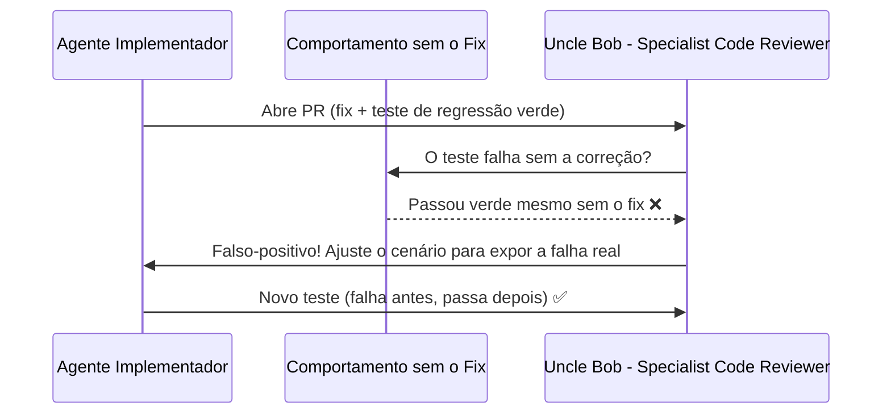

# O teste passou, mas pelo motivo errado: o perigo do CI verde mentiroso

Poucas coisas dão uma sensação tão boa quanto escrever uma correção, rodar a suíte de testes e ver tudo verde de primeira. E poucas coisas são tão perigosas quanto comemorar esse verde sem antes provar que o teste **falharia** sem a sua correção.

Essa semana li o relato [I'm Not on the DEV Team. I Still Debugged Their Missing Badges From Public Code. (And My First Test Was Wrong.)](https://dev.to/dj29/im-not-on-the-dev-team-i-still-debugged-their-missing-badges-from-public-code-and-my-first-test-18oo), do Dhruv Jani, e ele ilustra perfeitamente um dos problemas que mais vigio na minha squad de agentes de IA. *(Nota: os agentes da minha squad usam nomes como `Uncle Bob - Specialist Code Reviewer` e `Ryan Dahl - Specialist Node`; são personas inspiradas em referências da área para dar identidade a cada função, sem envolvimento das pessoas reais.)*

## O caso das badges do DEV (Forem)

Sem acesso ao banco de produção nem ao Slack interno, apenas lendo o repositório público `forem/forem`, o autor descobriu por que ninguém recebia as badges de múltiplos commits (`4x-commit-club` em diante):

1. Os slugs salvos no banco não batiam com as constantes hardcoded no serviço, e um `.compact` descartava tudo em silêncio.
2. O método que concedia as badges rodava `BadgeAchievement.create(...)` toda hora no cron, em vez de `.where(...).first_or_create(...)` para garantir idempotência.

Ele abriu o PR #24113 corrigindo o serviço e escreveu um teste de regressão: chamou o serviço duas vezes seguidas e verificou que o usuário continuava com apenas `1` conquista criada.

Tudo verde no CI. Parecia fechado.

## A reviravolta no code review: o teste já passava na `main`

Durante o code review, veio a pegadinha: **aquele teste novo também passava na `main` sem a correção dele.**

Por quê? Porque a factory padrão de `badge` no projeto vinha com `allow_multiple_awards: false`. Na `main`, a segunda chamada ao `.create` batia na validação de unicidade do ActiveRecord (`validates :badge_id, uniqueness: ...`), falhava silenciosamente e mantinha a contagem em `1`.

Ou seja: o teste não estava exercitando o `first_or_create` que ele escreveu. Estava apenas testando o validador padrão do modelo! Quando ele mudou o cenário do teste para `allow_multiple_awards: true` (onde o `.create` antigo realmente duplicava registros), o teste finalmente passou a proteger o comportamento certo.

## Por que isso é ainda mais crítico com agentes de IA

Quando peço para o **Ryan Dahl - Specialist Node**, o **James Gosling - Java Champion** ou o **Vlad Mihalcea - Specialist DB** corrigirem um bug, o fluxo natural de um agente é entregar o código e o teste no mesmo commit.

Se ninguém questionar, acontecem três armadilhas clássicas:

- **O teste que só concorda com a implementação:** o agente escreve uma asserção que passa por causa de um valor default de factory ou fixture, exatamente como aconteceu no Forem.
- **O mock que testa o próprio mock:** o teste intercepta a chamada que tinha o bug e valida que o mock retornou o que foi configurado na linha de cima.
- **Asserção só no estado final, ignorando o mecanismo:** contar se existe 1 registro no final não diferencia "não tentou inserir duplicata" de "tentou inserir, tomou erro silencioso e engoliu".

Na minha squad, quem escreve nunca aprova o próprio PR. O **Uncle Bob - Specialist Code Reviewer** tem uma instrução explícita na skill dele: ler o diff procurando **testes que não testam nada** e rodar a suíte por conta própria. Até aqui, essa revisão separada já barrou `[MÉTRICA REAL: quantidade de PRs em que o Uncle Bob - Specialist Code Reviewer identificou testes falso-positivos ou mocks viciados antes do merge]`.

## O checklist que adotei para testes de regressão

A lição do artigo original virou regra prática no meu dia a dia:

1. **Veja o teste quebrar primeiro:** antes de comemorar o verde, faça `git stash` da correção (ou rode o teste antes de editar o código de produção). Se o teste de regressão passar na `main`, ele não é um teste de regressão.
2. **Teste o modo de falha, não só o caminho feliz:** desative a rede de segurança acidental da fixture (como o `allow_multiple_awards: true` no caso do Forem) para forçar o caminho que realmente quebrava.
3. **Valide o mecanismo além do resultado:** se a correção era evitar chamadas ou inserções desnecessárias, verifique que a operação extra não foi disparada, e não apenas que o saldo final bateu.

Qual foi a vez mais traiçoeira em que um teste seu ficou verde pelo motivo completamente errado?
