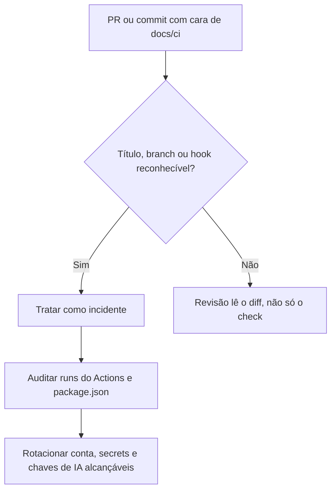

# O CI também é cadeia de suprimentos: o que a campanha wfx-loot ensina à minha squad

Quando um PR se chama `docs: dependency audit notes`, o instinto é tratar como documentação. Na semana de 10 de novembro, esse título foi a sonda de uma campanha que a Aikido Security batizou de wfx-loot: credenciais roubadas do GitHub usadas para plantar um ladrão de segredos no CI.

Escrevo como engenheiro que opera uma squad de agentes de IA e que já tratou, neste blog, da cadeia de suprimentos desses agentes e da rotação de segredos. *(Nota: quem são os agentes da minha squad e qual o papel de cada um está em [Apresentando o squad](/artigos/apresentando-o-squad.html) e em [Por que troquei um assistente de IA por uma squad de agentes especializados](/artigos/squad-de-agentes-especializados.html). Os nomes são personas inspiradas em referências da área, usadas só para dar identidade a cada função, sem qualquer envolvimento das pessoas reais.)* Não relato um incidente meu. Leio o que foi publicado e levo o que dá para aplicar amanhã.

## O que as fontes descreveram

No texto de 12 de novembro de 2026, a Aikido diz que a onda começou por volta das 12:45 UTC de 10 de novembro. Segundo os dados que a empresa tinha naquele dia, 4.837 contas comprometidas abriram PRs de sondagem em 61.764 repositórios, e em pelo menos 1.835 deles o payload rodou e credenciais saíram. A sonda era o PR `docs: dependency audit notes`, aberto a partir de um branch `wfx-docs`, só para confirmar acesso de escrita. A Aikido é explícita: se a sonda rodou, aquela conta está comprometida, mesmo que a etapa do workflow malicioso não tenha rodado. Do total de PRs, 10.431 foram para repositórios dos quais a conta não era dona, alcançados por acesso de colaborador ou de organização, e 92% deles ainda estavam abertos, o que sugere que a maioria dos donos não tinha percebido.

Depois vinha o payload, em uma de três variantes: um commit `ci: refresh build cache` que injeta cerca de 1.500 linhas num workflow já existente; um commit `chore: add dependency audit workflow` com um workflow descartável num branch `chore/` seguido de oito caracteres aleatórios; ou um commit `chore: add ci helper` com um script escondido e um hook `postinstall` no `package.json`, que roda a cada `npm install`. O script, ainda segundo a Aikido, não mirava só o `GITHUB_TOKEN` e os secrets do Actions. Entravam credenciais de nuvem e também chaves de provedores e ferramentas de IA: OpenAI, Anthropic, Gemini, Hugging Face, Cursor, Copilot, entre outras listadas no relatório. Em até um minuto o ator revertia a mudança e apagava a run com os logs; muitas vezes o único rastro é um número de run faltando no histórico do workflow. O BleepingComputer, no mesmo dia, repetiu esses números e o conselho de procurar o branch `wfx-docs`, o PR de sondagem e buracos na numeração das runs.

A GitGuardian, em 13 de novembro, acrescenta um detalhe de defesa. Ela conta quatro formas de entrega (incluindo anexar o payload a um script shell existente) e diz que toda run de novembro que ainda dava para observar, nas formas que alteravam arquivo de workflow, ficou retida pelo GitHub em `action_required` e nunca começou. O hook do npm, que não mexe em workflow nenhum, passou por fora dessa trava: o próprio workflow do repositório, intacto e já confiável, rodava `npm install`, e o script ia junto. A empresa diz ter logs públicos de 19 repositórios em que o script executou, 18 deles reportando exfiltração bem-sucedida.

## Por que isso fala com a minha squad

A squad entrega por pull request e por CI. O Actions guarda o token de deploy e as chaves com que os agentes chamam os modelos. Se um job usa uma chave de provedor, ela está no mesmo lugar que o wfx-loot tentou esvaziar.

Já escrevi que [atualizar o pacote é a parte fácil](/artigos/supply-chain-rotacao-segredos.html) e que [o merge do PR não garante a correção](/artigos/o-merge-levou-o-pr.html). Aqui a lógica se inverte: um CI verde depois de um commit estranho não prova que o segredo continua só comigo. Um PR com cara de docs, aberto por uma conta que de fato tem acesso de escrita, passa se a revisão estiver no piloto automático, o modo *human-on-the-side* de que falei no [texto sobre o deskilling do SRE](/artigos/sre-deskilling-squad-de-agentes.html).

Quem trabalha com agentes se acostuma a ver commits `chore:`, `ci:` e `docs:` gerados por máquina. A campanha escolheu justamente essa linguagem. Não estou dizendo que a minha squad foi alvo. Estou dizendo que o ruído que eu mesmo produzo pode esconder o PR que eu deveria parar para ler.

## O que eu levo para o fluxo

São práticas que recomendo e procuro seguir.

1. **Tratar título e branch estranhos como incidente.** PR `docs: dependency audit notes`, branch `wfx-docs`, commits `ci: refresh build cache` ou `chore: add ci helper`, ou um `chore/` com oito caracteres aleatórios pedem busca no histórico, inclusive na numeração das runs. Se a sonda existiu, a conta que abriu o PR precisa de rotação.

2. **Não achar que “o GitHub segurou o workflow” encerra o caso.** A GitGuardian mostrou o desvio pelo hook de instalação. Revisar `package.json` e script novo na raiz entra no mesmo checklist que o YAML do Actions.

3. **Rotacionar o que o job alcança, não só o que o YAML cita.** Se houver indício de que o payload rodou, a Aikido recomenda assumir como comprometido todo segredo e papel de nuvem disponível àquele workflow. A GitGuardian vai na mesma linha: vale para todos os secrets do repositório e da organização, não só os que o workflow referencia. Isso inclui chave de modelo e de ferramenta de agente.

4. **Separar a identidade do agente da do CI.** A chave com que a squad fala com o modelo não deveria ser a mesma do runner. No [servidor de memória compartilhada](/artigos/ai-memory-tailscale-memoria-compartilhada.html) eu já uso uma chave por cliente; o CI merece o mesmo menor privilégio.

5. **Na revisão, ler o diff, não só o check.** Se eu aprovo no automático um PR de “docs” porque a esteira ficou verde, estou na brecha que essa campanha usou.

O wfx-loot não inventou o roubo de segredo no CI; a própria GitGuardian liga a técnica a campanhas anteriores, como a GhostAction. O que ele mostrou, em escala e com a linguagem de commit que qualquer squad de agentes reconhece, é que o cofre está no mesmo lugar onde a gente pede para a esteira “só rodar mais uma vez”. Esse é o mesmo ponto de [A cadeia de suprimentos dos agentes](/artigos/cadeia-de-suprimentos-dos-agentes.html), agora do lado do CI.

Na sua esteira, você perceberia um número de run faltando? E saberia quais chaves de modelo aquele job ainda alcança?

## Fontes

- Aikido Security — [wfx-loot campaign pushes CI secret stealer to tens of thousands of repositories](https://www.aikido.dev/blog/compromised-github-accounts-push-ci-secret-stealer-to-tens-of-thousands-of-repositories), de Oliver Smith, 12/11/2026
- GitGuardian — [wfx-loot: A CI Secret Stealer Pushed With Stolen GitHub Credentials](https://blog.gitguardian.com/wfx-loot-a-ci-secret-stealer-pushed-with-stolen-github-credentials/), de Gaetan Ferry, 13/11/2026
- BleepingComputer — [Hackers compromise 4,800 GitHub accounts to steal cloud credentials](https://www.bleepingcomputer.com/news/security/hackers-compromise-4-800-github-accounts-to-steal-cloud-credentials/), de Bill Toulas, 12/11/2026 (cobertura da mesma campanha)
- Artigos deste blog citados no texto: [A cadeia de suprimentos dos agentes](/artigos/cadeia-de-suprimentos-dos-agentes.html), [Atualizar o pacote é a parte fácil](/artigos/supply-chain-rotacao-segredos.html), [O merge levou o PR, mas não a correção](/artigos/o-merge-levou-o-pr.html), [A IA não está substituindo o SRE, está tirando a prática dele](/artigos/sre-deskilling-squad-de-agentes.html), [Memória compartilhada para uma squad de agentes](/artigos/ai-memory-tailscale-memoria-compartilhada.html)
