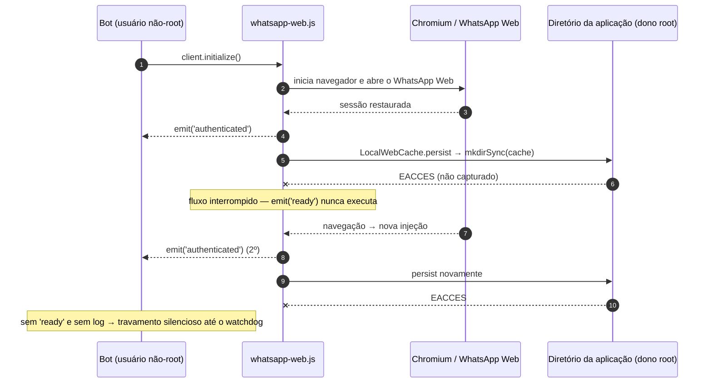

# PM-0001 — Bot de WhatsApp autenticava mas não chegava a `ready` após mudança na imagem Docker

> **Post-mortem blameless.** O foco está em sistemas e processos, não em pessoas. Esta é uma versão pública e sanitizada: identificadores internos, detalhes de infraestrutura e dados pessoais foram omitidos.

| Campo | Valor |
|---|---|
| Status | Resolvido — ações de acompanhamento em aberto |
| Componente | Bot de WhatsApp baseado em [whatsapp-web.js](https://github.com/pedroslopez/whatsapp-web.js), rodando em container Docker |
| Duração | Alguns dias de investigação; indisponibilidade total de cerca de 4 minutos, somente em janelas de teste |

## 1. Resumo

Depois de uma mudança na imagem Docker (migração para um Dockerfile multi-stage), o bot passou a autenticar no WhatsApp — o evento `authenticated` era emitido, inclusive duas vezes — mas **nunca chegava ao evento `ready`**. Sem `ready`, o bot não processa mensagens.

A causa raiz foi de permissão de filesystem: **o diretório de cache não era gravável pelo usuário do container**. O whatsapp-web.js tenta criar esse diretório logo após autenticar, sem tratar o erro, e o `EACCES` resultante interrompia o fluxo de boot silenciosamente.

Uma correlação inicial equivocada com a versão do Chromium levou a um pin temporário do navegador, depois removido. O Chromium **não** era a causa.

## 2. Impacto

- A produção continuou atendendo durante a investigação com uma imagem anterior que não tinha o problema.
- Indisponibilidade somente durante janelas de teste e troca de imagem: quatro janelas curtas (de ~20 segundos a ~3 minutos), **cerca de 4 minutos no total**.
- Custo colateral: o pin temporário manteve, por alguns dias, uma versão do Chromium sem correções de segurança recentes, com mitigações compensatórias.

## 3. Linha do tempo (relativa)

| Fase | Evento |
|---|---|
| Dia 1 | Mudança do Dockerfile para multi-stage. As novas imagens autenticam mas não chegam a `ready`. |
| Dia 1 | Testes com diferentes versões do Chromium sugerem (erroneamente) uma regressão do navegador; pin temporário aplicado. |
| Dia 1 | A imagem com o pin **também trava** → Chromium deixa de ser suspeito. |
| Dia 1 | Imagens de diagnóstico variando uma variável por vez (bibliotecas, dependências, fontes, sandbox) → sem efeito. |
| Dia 1 | Correção para o `authenticated` duplicado é implantada; o duplicado passa a ser ignorado, mas ainda sem `ready`. Rollback em ~3 min. |
| Dia 1 | Surge a hipótese de `EACCES` no diretório de cache do whatsapp-web.js. |
| Dia 4 | Teste com o diretório de cache montado como gravável pelo usuário do container → `ready` em ~20 s. **Causa confirmada.** |
| Dia 4 | Imagem corrigida implantada → `ready` em ~16 s. |
| Dia 4 | Pin do Chromium removido; imagem com Chromium atual → `ready` em ~14 s. |

## 4. Investigação — hipóteses descartadas

| Hipótese | Resultado |
|---|---|
| Regressão na versão do Chromium | Descartada: a imagem com a versão "boa" fixada também travava |
| Memória insuficiente | Descartada |
| Volumes montados | Descartada |
| Usuário do processo | Descartada isoladamente (o problema era a combinação usuário × dono do diretório) |
| Tamanho de `/dev/shm` | Descartada |
| Sandbox do Chromium | Descartada |
| Bibliotecas do sistema, dependências e fontes | Descartadas |
| Corrida entre `authenticated` e injeção de scripts | Corrigida, mas não era a causa: o `ready` continuou ausente |
| **Diretório de cache não gravável** | **Confirmada** |

## 5. Causa raiz

- O Dockerfile passou de single-stage para multi-stage, com estágios `build` e `runtime`.
- No estágio `runtime`, o diretório da aplicação era criado por `root` via `WORKDIR` e, em seguida, o processo passava a rodar como um usuário não-root (`USER`).
- Os `COPY --chown` cobriam apenas os artefatos copiados; o próprio diretório da aplicação ficou pertencendo a `root`, sem permissão de escrita para o usuário do runtime.

### Mecanismo

1. O whatsapp-web.js emite `authenticated` **antes** de persistir o cache da versão do WhatsApp Web (`LocalWebCache`).
2. `LocalWebCache.persist` chama `mkdirSync`/`writeFileSync` **sem try/catch**; o `EACCES` interrompe o fluxo antes de `emit('ready')`.
3. Uma navegação da página provoca nova injeção e um segundo `authenticated`, o que mascarou o sintoma como uma "condição de corrida".
4. O diagnóstico de boot só era registrado após `ready` e o watchdog tinha um timeout longo, então o travamento era silencioso.

## 6. Por que o pin do Chromium parecia funcionar

A imagem que "funcionou" com a versão antiga do Chromium era uma imagem híbrida de diagnóstico na qual o diretório da aplicação pertencia ao usuário do runtime. Ela diferia da imagem problemática em **mais de uma variável** (versão do Chromium **e** dono do diretório), e a melhora foi atribuída ao navegador.

## 7. Correção

- **Build:** o diretório de cache é criado no build, pertencendo ao usuário do runtime e com permissões restritas, antes da instrução `USER`. O restante do diretório da aplicação continua somente leitura para esse usuário.
- **Fail-fast no boot:** antes de `client.initialize()`, o bot verifica se o diretório de cache é gravável. Se não for, encerra com erro claro e log específico, sem abrir o navegador nem contatar o WhatsApp — evitando rajadas de reconexão.
- **CI:** um smoke test executa a imagem como o usuário do runtime e verifica dono, permissões e escrita no diretório de cache **antes** de publicar a imagem.
- O pin temporário do Chromium foi removido e o navegador voltou às atualizações normais da distribuição.

## 8. Por que o CI não pegou

- O pipeline fazia build, varredura de vulnerabilidades e publicação, mas **nunca executava a imagem** como o usuário de runtime.
- Os testes unitários rodam fora do container e não exercitam permissões da imagem.

## 9. Lições aprendidas

**Deu certo**
- Isolamento metódico, uma variável por vez, descartou várias hipóteses rapidamente.
- Um teste barato e conclusivo (tornar o cache gravável) confirmou a causa antes de mudar a imagem.
- O pin temporário tinha data de expiração explícita e foi removido antes dela.
- Rollbacks rápidos.

**Deu errado**
- Diagnóstico registrado apenas após `ready` não deixou rastro do travamento.
- Um erro síncrono não capturado dentro de uma biblioteca se manifestou como "travamento", não como erro.
- Imagens comparadas diferiam em mais de uma variável, levando a uma conclusão errada.
- O CI não executava a imagem como o usuário de runtime.
- Logs do incidente foram descartados antes do post-mortem.

**Lições gerais**
- Em Dockerfiles multi-stage com usuário não-root, declare explicitamente todos os caminhos graváveis e verifique-os no CI.
- Ao comparar um ambiente "bom" com um "ruim", garanta que eles difiram em uma única variável.
- Bibliotecas podem engolir ou não tratar erros de I/O: valide pré-condições (como permissões) antes de inicializá-las.
- Emita sinais de observabilidade em cada etapa do boot, não só no sucesso final.

## 10. Ações

| # | Ação | Status |
|---|---|---|
| A1 | Verificação fail-fast do diretório de cache antes da inicialização | Concluído |
| A2 | Criar o diretório de cache no build com o dono correto + smoke test no CI | Concluído |
| A3 | Remover o pin temporário do Chromium | Concluído |
| A4 | Smoke test de boot no CI: subir a imagem com filesystem somente leitura (exceto caminhos graváveis declarados) até a etapa de QR code, exigindo ausência de `EACCES` | Aberto |
| A5 | Log leve no evento `authenticated` para que outros erros pós-autenticação deixem rastro | Aberto |
| A6 | Alertas para "autenticado sem `ready`" e para falhas recorrentes de boot | Aberto |
| A7 | Política de retenção de logs de incidente até o fechamento do post-mortem | Aberto |
| A8 | Checklist de investigação: comparações devem diferir em uma única variável | Aberto |
| A9 | Avaliar reportar ao upstream (whatsapp-web.js) o `EACCES` não tratado em `LocalWebCache.persist` | Aberto |
