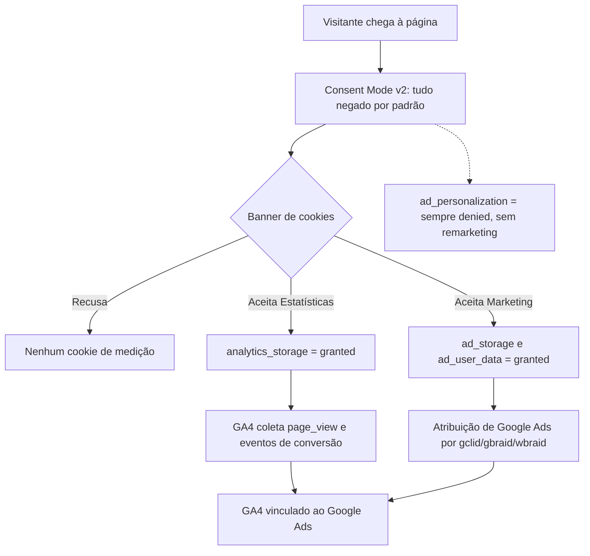

# PM-0002 — Do zero à produção em ~16 h: a landing page ética que uma squad de agentes entregou — e os 3 bugs que só a produção mostrou

> **Post-mortem blameless.** O foco está em sistemas e processos, não em pessoas. Esta é uma versão pública e sanitizada: domínio, identificadores de medição, repositório e dados pessoais foram omitidos.

*(Nota: quem são os agentes da minha squad e qual o papel de cada um está em [Apresentando o squad](/artigos/apresentando-o-squad.html) e em [Por que troquei um assistente de IA por uma squad de agentes especializados](/artigos/squad-de-agentes-especializados.html) — os nomes, como `Jordan Walke - Specialist React` e `Shannon Lietz - DevSecOps`, são personas inspiradas em referências da área apenas para dar identidade a cada função, sem qualquer envolvimento das pessoas reais.)*

| Campo | Valor |
|---|---|
| Status | Resolvido |
| Componente | Landing page estática para uma psicóloga, com GA4 (Consent Mode v2) e preparada para Google Ads |
| Duração | ~16 h do primeiro commit à v0.2.1; ~11 h até o primeiro deploy em produção |

## 1. Resumo

Na madrugada de 28 para 29/10/2026 comecei, num repositório vazio, uma landing page para uma psicóloga. Às 15:53 do dia 29 a v0.2.1 estava em produção, com GA4, Consent Mode v2 estrito e atribuição pronta para Google Ads. Quem escreveu quase todo o código foi uma squad de agentes; eu decidi merges e releases.

A ideia deste post é uma só: **os agentes me deram velocidade, mas o que deixou a página pronta para produção foram as travas.** Ética do CFP e LGPD desde o primeiro commit, um CI em que release só sai por label, e validação de verdade em produção — não "o build passou". Foi essa validação que mostrou três bugs que nenhum teste local tinha mostrado.

## 2. Linha do tempo (UTC-3)

| Horário | Evento |
|---|---|
| 28/10 23:52 | Primeiro commit, repositório vazio |
| 29/10 00:07 | MVP com textos e `aria-label`s centralizados em `content.json` |
| 07:37 | Widget de conversa via WhatsApp |
| 08:22–08:51 | Redesign editorial |
| 09:04–09:19 | Revisão ética (CFP/LGPD), política de privacidade, headers de segurança (CSP/HSTS) |
| 10:08 | GA4 com Consent Mode estrito + banner de cookies |
| 10:29–10:39 | Pipeline de CI/release |
| 10:40 | v0.1.0 — deploy falha (conflito entre `netlify-cli` e TypeScript) |
| 10:50 | v0.1.1 — primeiro deploy em produção |
| 11:09 | v0.1.2 — correção do banner + versão no rodapé |
| 12:33 | v0.2.0 — pronta para Ads: atribuição gclid/UTM, eventos `whatsapp_click`/`email_click`/`chat_start`, consentimento de Marketing, testes |
| 12:34–15:43 | Configuração de GA4/Ads e validação em produção (horários exatos não registrados) |
| 15:52 | v0.2.1 com as correções; em produção às 15:53 |

## 3. Como consentimento, GA4 e Ads se conectam

Antes dos bugs, o desenho. Nada de medição sai antes de a pessoa escolher, e personalização de anúncios nunca é concedida — não há remarketing.



## 4. As travas que vieram antes da velocidade

**Ética do CFP.** Para uma psicóloga, a publicidade tem regras. A página mostra o CRP de forma visível, não promete cura nem resultado, não tem depoimentos, não divulga preços e, para atendimento online, menciona o cadastro no e-Psi. Isso entrou na revisão das 09:04, antes de qualquer tag de medição existir.

**LGPD.** Política de privacidade própria, banner com duas categorias claras (Estatísticas e Marketing) e padrão "negado". Saúde mental é um contexto sensível; o mínimo de dados é o requisito, não o ideal.

**Headers de segurança.** CSP restritiva e HSTS desde cedo. A CSP depois cobrou seu preço (bug 1), mas foi justamente por ela ser estrita que o problema ficou visível.

**Atribuição com allowlist.** Só `gclid`, `gbraid`, `wbraid` e `utm_*` são lidos da URL, guardados em `sessionStorage` e removidos da barra de endereço. Nada fora da lista é persistido.

**CI/CD por label.** O fluxo, especificado pela Shannon Lietz, é: label no PR → tag → GitHub Release → deploy via Netlify CLI. Os builds automáticos da Netlify ficaram desligados para economizar custo — só sobe o que virou release. E a versão aparece no rodapé, para eu saber, olhando a página no celular, exatamente o que está no ar.

A primeira release mostrou que a trava funciona: a v0.1.0 falhou no deploy por um conflito entre o `netlify-cli` e o TypeScript, e dez minutos depois a v0.1.1 subiu. Falhar no pipeline é barato; falhar em produção, não.

## 5. Bug 1 — A CSP bloqueava o GA4

**Sintoma.** No console: `Fetch API cannot load https://analytics.google.com/g/collect`. Os hits caíam para `www.google.com` e `stats.g.doubleclick.net`, e o GA4 mostrava "nenhum dado recebido".

**Hipótese e diagnóstico.** O primeiro suspeito foi o consentimento. Mas o erro era explícito: violação de CSP. Olhando a diretiva `connect-src`, ela tinha `https://*.analytics.google.com`.

**Causa.** O curinga `*.` cobre subdomínios, mas **não** o host "pelado" `analytics.google.com`. Parece óbvio escrito assim; na hora, a linha "parecia certa".

**Correção.** Um diff genérico:

```diff
- connect-src 'self' https://*.analytics.google.com ...
+ connect-src 'self' https://analytics.google.com https://*.analytics.google.com ...
```

**Trava.** O checklist de validação em produção ganhou um item: zero erros de CSP no console e hits de coleta respondendo 204.

## 6. Bug 2 — O clique no e-mail não virava conversão

**Sintoma.** Clicar no link de e-mail gerava só o evento de rolagem; `email_click` não aparecia.

**Diagnóstico.** Duas coisas somadas. O transporte padrão do gtag agrupa e atrasa envios, e um link `mailto:` entrega o controle ao app de e-mail — a página pode perder o hit antes de enviá-lo. Além disso, esse hit também esbarrava na CSP do bug 1.

**Correção.** Uma função `trackOutbound()` que envia com `transport_type: 'beacon'`, usa `event_callback` com `event_timeout` de 800 ms, tem um `setTimeout` de reserva e uma guarda contra execução dupla. Um esboço ilustrativo (ele assume que o handler de clique já chamou `preventDefault()` no link; sem isso, o navegador navega antes do envio e o esboço não serve):

```js
function trackOutbound(eventName, href) {
  let done = false;
  const go = () => { if (done) return; done = true; window.location.href = href; };
  gtag('event', eventName, {
    transport_type: 'beacon',
    event_callback: go,
    event_timeout: 800,
  });
  setTimeout(go, 1000);
}
```

De quebra, `chat_start` passou a disparar no máximo uma vez por sessão (marcado em `sessionStorage`), para não inflar conversões.

**Trava.** Dois testes novos: um para o envio via beacon com navegação garantida, outro para a deduplicação de `chat_start`.

## 7. Bug 3 — O site "fora do ar" que nunca caiu

**Sintoma.** A validação automatizada recebeu `ERR_CONNECTION_CLOSED`. No meu celular, `DNS_PROBE_FINISHED_NXDOMAIN`. Parecia que o site tinha caído logo depois do deploy.

**Diagnóstico.** Uma consulta DNS via DoH mostrou que o registro `.com.br` respondia NXDOMAIN — o domínio não existia. E não existia mesmo: o domínio que circulou numa mensagem de handoff entre agentes tinha um "i" a mais. O site esteve no ar o tempo todo.

**Causa.** Um dado crítico copiado de mensagem para mensagem, em vez de lido da fonte.

**Trava.** Antes de testar, verificar o domínio na fonte (memória/configuração do projeto), não no texto do handoff. E conferir que o stream do GA4 e a URL final dos anúncios usam o domínio correto — um erro de digitação ali não derruba o site, mas joga campanha e medição no vazio.

## 8. Aprendizado extra: a ordem importa no teste do gclid

Para testar a atribuição, é preciso **aceitar o consentimento antes** de carregar a URL com `gclid`. Se a URL com o parâmetro abre primeiro, o consentimento ainda está negado e o teste mede um cenário diferente do que se quer validar. Parece detalhe; custou tempo de validação.

## 9. Quem fez o quê na squad

- **Jordan Walke** (frontend): escreveu os PRs, a CSP e os eventos, e fez a validação em produção.
- **Larry Page & Sergey Brin** (GA4 e Ads): plano de tagueamento, checklist de Ads, revisão do PR de Ads, vínculo GA4–Ads e a proposta de campanha.
- **Shannon Lietz** (DevSecOps): especificou o fluxo de CI, release e deploy.
- **Eu**: decidi cada merge e cada release.

Uma squad rápida precisa de um humano que segure o botão de publicar. Não por desconfiança dos agentes, mas porque é ali que alguém responde pela página de uma profissional de saúde.

## 10. Lições e checklist

1. **Ética e privacidade entram no primeiro dia.** Retrofit de CFP e LGPD numa página pronta é mais caro do que construir com eles.
2. **CSP estrita é aliada, desde que alguém leia o console em produção.** Curinga não cobre o host raiz.
3. **Links de saída precisam de beacon.** `mailto:` e WhatsApp tiram o usuário da página.
4. **Dados críticos se leem da fonte, não do handoff.** Domínio, IDs e URLs finais.
5. **"Build verde" não é validação.** Validação é hit 204 no GA4, evento chegando e console limpo.

Checklist que ficou para a próxima landing page:

- [ ] CRP visível, sem promessas, sem depoimentos, sem preços, e-Psi se houver atendimento online
- [ ] Política de privacidade e banner com Estatísticas/Marketing negados por padrão
- [ ] `ad_personalization` sempre negado
- [ ] Zero erros de CSP; hits de coleta com 204
- [ ] Eventos de conversão com beacon e deduplicação
- [ ] Domínio conferido na fonte; stream do GA4 e URL final dos anúncios batendo
- [ ] Consentimento aceito antes de testar `gclid`
- [ ] Versão no rodapé igual à da última release

Resultado de campanha ainda não há; volto a este post quando houver dados.

## 11. Fechamento

Dezesseis horas é rápido. Mas o número que me interessa não é esse; é que os três bugs foram achados por mim e pela squad, em produção controlada, e não pela psicóloga nem por um paciente. Os agentes escreveram o código. As travas decidiram quando ele estava pronto.
